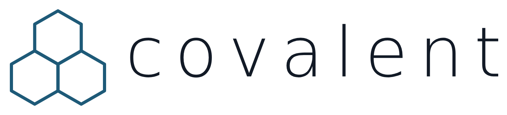

<p align="center">
  <br><br>
  <picture>
    <source media="(prefers-color-scheme: dark)" srcset="doc/images/brand/covalent-logo-trio-sombre.png">
    
  </picture>
  <br><br>
</p>

# Covalent

[](LICENSE)
[](https://openjdk.org/projects/jdk/21/)

**A lightweight Java component model and runtime container.**

As a Java application grows, the class stops being a unit its architecture can
be reasoned about with: there end up being too many of them, wired together by
hand, for the shape of the system to stay visible in the code. What is needed
at that point is a coarser, more structuring unit to build around - the
component.

A component still talks to other components the way ordinary Java objects do -
by calling methods - but through a declared service rather than a direct
reference to another object's implementation. That one change is a real
refinement over plain object programming: what a component offers and what it
needs become visible in its interfaces, not buried inside its code, and a
container can act on that visibility.

Acting on it is the other half of the idea. A component delegates to the
container what would otherwise be threaded by hand through the whole
application: finding a collaborator, starting and stopping it in the right
order, reacting when it fails, holding its configuration. Covalent is that
container: a lightweight component model and runtime for a single JVM
process, keeping dependency injection, event subscriptions, lifecycle
callbacks and configuration (and many others features) out of business
code and into the container itself.

Java 21 | MPL-2.0 | core with no third-party runtime dependency

> Status: 1.0.0. No artifact is published; install from
> source (see [Using Covalent](#using-covalent)).
> [Issues](https://github.com/opales-org/covalent/issues) are open for bugs and
> questions.

**Documentation:** [Tutorial](doc/tutorial/index.md) ·
[User Guide](doc/user-guide.md) · [Examples](doc/examples.md) ·
[Supervision](doc/supervision.md) · [Troubleshooting](doc/troubleshooting.md)
· [FAQ](doc/faq.md) - see [Where To Go Next](#where-to-go-next) below for
what each one covers.

## Why Covalent

- **Sophisticated events.** Each subscriber can use its own filter, producers can be
  told about new subscribers, event data can be cloned automatically, and dispatch
  is asynchronous by default.
- **Components at two scales.** Composition organizes an application as a tree of
  components; items segment the implementation of a single component.
- **Parameters as ports.** Configuration is exposed through typed interfaces with
  their own lifecycle timing, available from the initialization of a component.
- **A robust container.** Each component goes through a managed lifecycle -
  deployment, instantiation, initialization, activation, passivation, removal and
  undeployment - and its provided ports are usable by others only while it is
  activated. Lifecycle failures are contained and reported, and every startup and
  shutdown returns a report. See [Lifecycle](doc/managed-components.md#lifecycle).
- **A container you can see.** The component viewer lets you inspect a running
  container.
- **Progressive adoption.** Existing Java objects can join the runtime as raw
  components, while new code uses fully managed components.

The goal is not to hide architecture behind magic, but to make component
boundaries, ports, and lifecycle explicit enough for large applications to stay
understandable as they grow. If you are weighing Covalent against Spring, Guice
or OSGi, see [Compared To Other Approaches](doc/foundations.md#compared-to-other-approaches).

## Getting Started

This example declares three components: `Orders` provides a service to place an
order and produces an event each time it does; `Kitchen` subscribes to that event
with a filter, so it only hears about the orders it cares about; `Application`
drives the service. No component knows about the others beyond the interfaces
they share.

```java
import org.opales.covalent.Covalent;
import org.opales.covalent.container.CovalentContainer;
import org.opales.covalent.container.component.annotations.Component;
import org.opales.covalent.container.component.annotations.Events;
import org.opales.covalent.container.component.annotations.EventsFilter;
import org.opales.covalent.container.component.annotations.EventsSubscribe;
import org.opales.covalent.container.component.annotations.Implementation;
import org.opales.covalent.container.component.annotations.ProducedEvents;
import org.opales.covalent.container.component.annotations.Services;
import org.opales.covalent.container.component.annotations.UsedEventsSubscribe;
import org.opales.covalent.container.component.annotations.UsedServices;
import org.opales.covalent.container.lifecycle.Activation;

public final class Launcher {

    @Component
    public interface Orders { }

    @Services
    public interface OrderServices {
        void placeOrder(String product, int quantity);
    }

    @Events
    public interface OrderEvents {
        void onOrderPlaced(String product, int quantity);

        @EventsSubscribe
        interface OrderEventsSubscribe {
            void subscribe(OrderEvents observer, OrderEventsFilter filter);
        }

        @EventsFilter
        interface OrderEventsFilter {
            boolean filterOrderPlaced(String product, int quantity); // true = filtered out
        }
    }

    @Implementation
    public static final class OrdersImpl implements Orders, OrderServices {
        @ProducedEvents private OrderEvents produceOrderEvents;
        public void placeOrder(final String product, final int quantity) {
            this.produceOrderEvents.onOrderPlaced(product, quantity);
        }
    }

    @Component
    public interface Kitchen { }

    @Implementation
    public static final class KitchenImpl implements Kitchen, OrderEvents {
        @UsedEventsSubscribe private OrderEvents.OrderEventsSubscribe useOrderEventsSubscribe;

        @Activation
        public void subscribeToCroissants() {
            this.useOrderEventsSubscribe.subscribe(this, new CroissantsOnly());
        }

        public void onOrderPlaced(final String product, final int quantity) {
            System.out.println("Kitchen: preparing " + quantity + " x " + product);
        }

        private static final class CroissantsOnly implements OrderEventsFilter {
            public boolean filterOrderPlaced(final String product, final int quantity) {
                return !"croissant".equals(product);
            }
        }
    }

    @Component
    public interface Application { }

    @Implementation
    public static final class ApplicationImpl implements Application {
        @UsedServices private OrderServices useOrderServices;
        @Activation public void run() {
            this.useOrderServices.placeOrder("coffee", 2);
            this.useOrderServices.placeOrder("croissant", 1);
        }
    }

    public static void main(final String[] args) {
        CovalentContainer container = Covalent.main;
        container.getParameters().setSynchronousEvents(true);
        try {
            container.deployComponents(OrdersImpl.class, KitchenImpl.class, ApplicationImpl.class);
            container.start();
        } finally {
            if (container.isStarted()) {
                container.stop();
            }
        }
    }
}
```

Running it prints `Kitchen: preparing 1 x croissant`: the coffee order is placed
too, but `Kitchen` filtered it out before it ever reached `onOrderPlaced`. See the
[tutorial](doc/tutorial/index.md) for the full walk-through, one idea at a time,
starting from an even smaller first component.

## How The Example Fits Together

The components of the [example above](#getting-started) are connected through
ports rather than through each other directly:


`Application` only knows the `OrderServices` interface, never the `Orders`
component's implementation; `Orders` only knows that some interfaces exist to
produce, never who (if anyone) subscribes. `Kitchen`'s filter (shown in the
[example above](#getting-started)) is why it only ever sees the croissant order,
not the coffee one. See [Lifecycle](doc/managed-components.md#lifecycle) for the
states a component goes through between deployment and undeployment.

## Component Viewer

Enable the component viewer, an optional extension provided by the
`covalent-supervision` module, with:

```powershell
-Dcovalent.extensions=component-viewer
```

The viewer stays out of the way until it is needed, even on an application that is already
running: press <kbd>Ctrl</kbd>+<kbd>Shift</kbd>+<kbd>F12</kbd> in a window of the application, or
call the `openSupervisor` operation of the `org.opales.covalent:type=Supervision` MBean from
JConsole or VisualVM. See [Summoning the Supervisor](doc/supervision.md#summoning-the-supervisor).


The viewer also records the calls and events exchanged between components, and
shows them as a sequence diagram with the details of each message:


See the [Covalent Supervision Guide](doc/supervision.md) for what else
`covalent-supervision` provides, and for writing a custom extension of your
own.

## Using Covalent

### As A Dependency

No release of Covalent is published to a Maven repository. Install it to your
local repository from source:

```powershell
git clone https://github.com/opales-org/covalent.git
cd covalent
mvn -pl covalent-core -am install
```

`-am` also builds and installs the parent POM that `covalent-core` inherits from;
without it, an external project fails to resolve `covalent-parent` even though
`covalent-core` itself installed successfully. Then declare the dependency in
your own project:

```xml
<dependency>
    <groupId>org.opales</groupId>
    <artifactId>covalent-core</artifactId>
    <version>1.0.0</version>
</dependency>
```

Covalent uses reflection and runs in the unnamed module: put it on the classpath,
not the module path. See [Runtime Requirements and Compatibility](doc/requirements.md#runtime-requirements-and-compatibility).

### Building And Testing The Repository

Build the repository, run every test and check the Javadoc with the Maven
Wrapper (`mvnw` / `mvnw.cmd` at the repository root), on Windows:

```powershell
.\mvnw clean verify
```

or on Linux and macOS:

```bash
./mvnw clean verify
```

The wrapper downloads and pins the project's expected Maven version on first
use, so no pre-installed Maven is needed. A Java 21 JDK is still required on
the `PATH` or via `JAVA_HOME`.

See [Build and Tests](doc/requirements.md#build-and-tests) for the module
breakdown and the core-only build command.

## Where To Go Next

- [Tutorial](doc/tutorial/index.md): a step-by-step introduction with runnable
  examples, from your first component to events, lifecycle and composition.
- [User guide](doc/user-guide.md): the reference documentation, with the concepts,
  managed and raw components, annotations, configuration and glossary.
- [Examples](doc/examples.md): four runnable JavaFX applications built on
  Covalent, with a capability matrix and a chapter per demo.
- [Troubleshooting](doc/troubleshooting.md): common symptoms and the first checks to
  make.
- [FAQ](doc/faq.md): adopting Covalent (Java version, JavaFX, JPMS, stability), using
  it (thread-safety, event delivery, testing, the supervisor's cost) and its license.

## License

Covalent is released under the [Mozilla Public License 2.0](LICENSE). The Covalent
name and logo are not covered by that license. The [FAQ](doc/faq.md#licensing) answers
the usual questions about what it allows.
