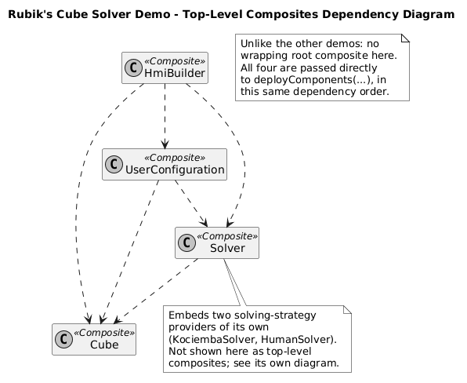
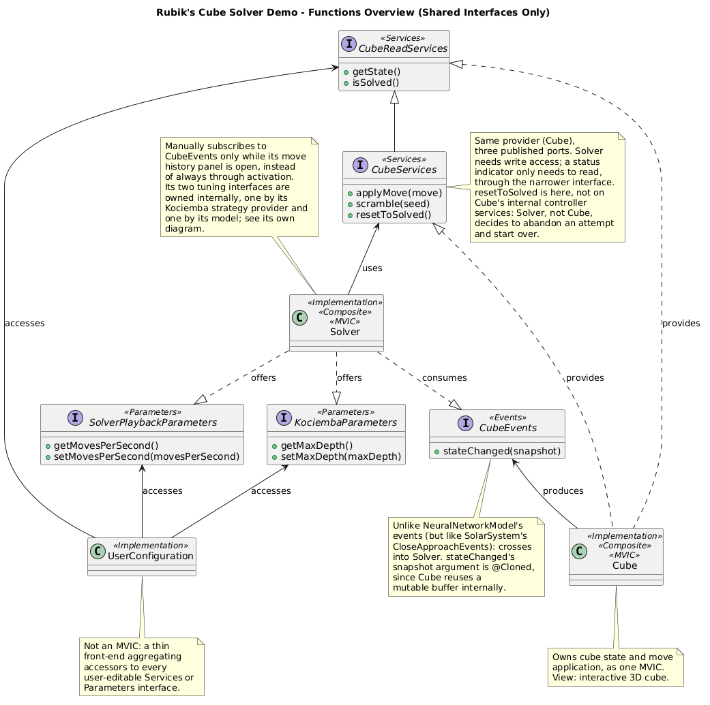
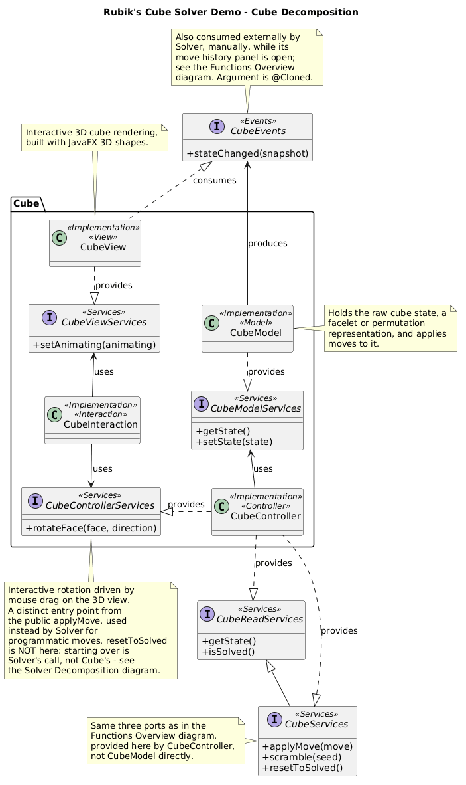
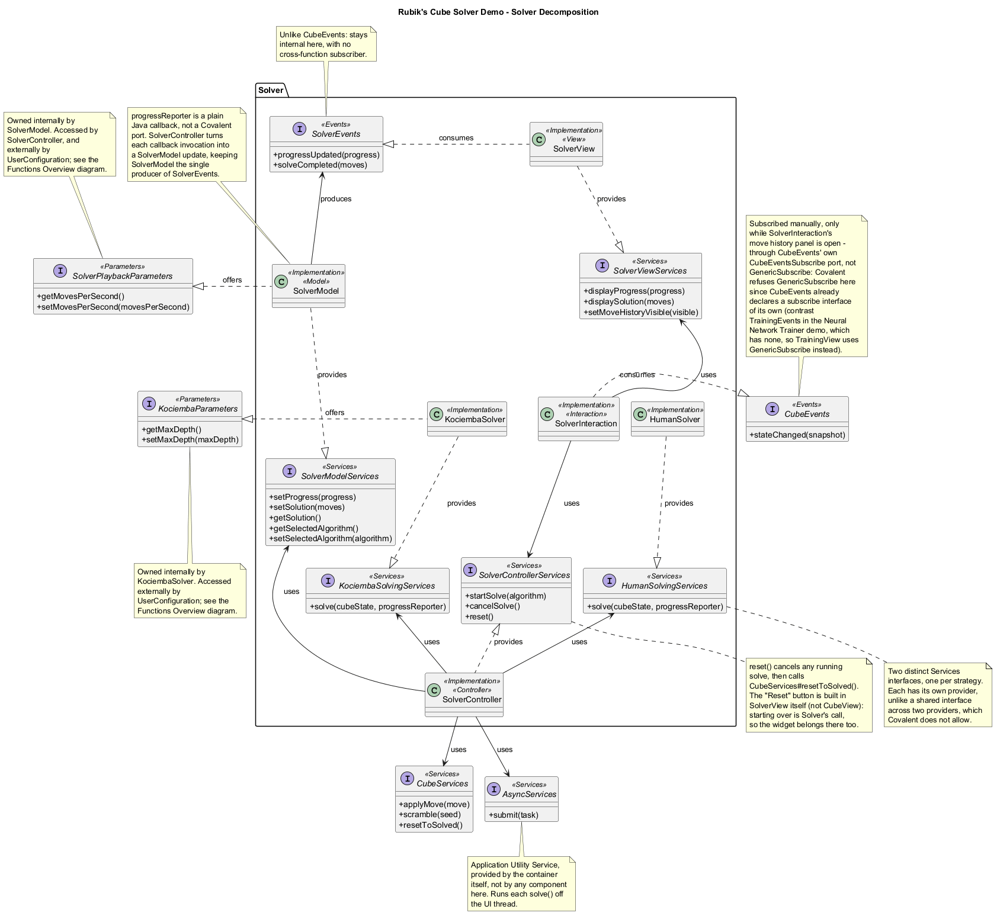
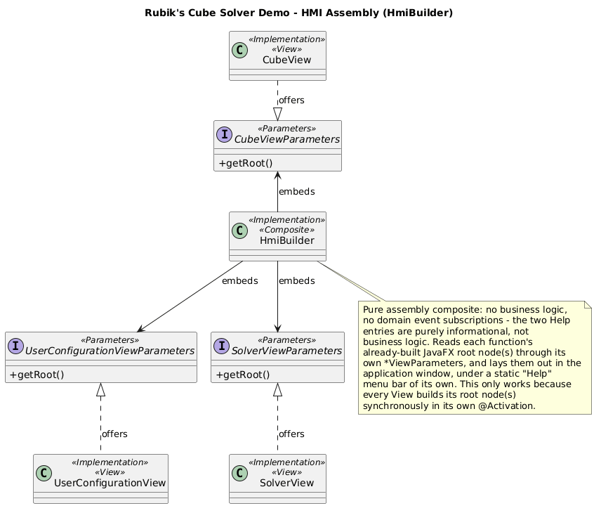

# Rubik's Cube Solver - Architecture

<!-- doc-nav:top -->
[Home](../../../../README.md) | [Previous: Ecosystem - Architecture](../ecosystem-demonstration/index.md) | [Next: Covalent Annotations Cheat Sheet](../../../annotations.md)
<!-- /doc-nav:top -->

# Table of Contents

- [Top-Level Composites](#top-level-composites)
- [Functions Overview](#functions-overview)
- [Per-Function Decomposition](#per-function-decomposition)
  - [Cube](#cube)
  - [Solver](#solver)
- [HMI Assembly](#hmi-assembly)

This page is the architecture reference for the
[Rubik's Cube Solver](../../../examples.md#rubiks-cube-solver)
demo: every top-level composite, how they depend on one another, the
interfaces shared between them, the internal MVIC decomposition of each
function, and how the HMI is assembled from all of it. It complements the
demo's entry in the [Examples Guide](../../../examples.md#rubiks-cube-solver),
which covers what the demo does and how to use it - this page is about how
it is built.

# Top-Level Composites



Four top-level composites: `Cube`, `Solver`, `UserConfiguration` and
`HmiBuilder`. Unlike Neural Network Trainer, Solar System Simulation and
Ecosystem, none of them is wrapped in a single root composite. The launcher
passes five classes directly to `container.deployComponents(...)`, in this
same dependency order: the HMI core, then `CubeImpl`, `SolverImpl`,
`UserConfigurationImpl` and `HmiBuilderImpl`. `Covalent`'s deployment model
needs nothing extra to support this - a composite only ever depends on
another composite's public interfaces, never on being listed inside some
larger wrapping class, so handing the container several composites at once
works exactly like handing it one. This is the point the demo is built to
make: a "root composite" is a convention every other demo in this project
happens to follow, not a requirement `deployComponents(...)` imposes.

`KociembaSolverImpl` and `HumanSolverImpl` are not top-level composites:
both are plain `@Implementation` fields composed inside `SolverImpl`,
alongside the `Solver` function's own MVIC quartet - see
[Solver](#solver) below.

# Functions Overview



`Cube` exposes two public interfaces instead of one:
`CubeServices extends CubeReadServices`. `CubeReadServices` carries the
two read-only operations (`getState()`, `isSolved()`); `CubeServices` adds
the three that mutate the cube (`applyMove(Move)`, `scramble(long)`,
`resetToSolved()`). This is
[extending services](../../../managed-components.md#extending-services):
`UserConfiguration` is written against `CubeReadServices` alone, so it
structurally cannot call `applyMove`, `scramble` or `resetToSolved`, while `Solver` is
written against the wider `CubeServices` to play out a found solution.
Both interfaces are provided by the same class, `CubeControllerImpl` - the
split is about which callers can reach which operations, not about which
component implements them.

`Solver` uses `CubeServices` to apply moves, and consumes `CubeEvents` to
trace them (see [Cube](#cube) below for how). It offers two `@Parameters`
interfaces of its own, `KociembaParameters` (owned internally by the
Kociemba strategy provider) and `SolverPlaybackParameters` (owned by
`SolverModel`, the speed at which a found solution is played onto the
cube), both accessed externally by `UserConfiguration`, alongside
`CubeReadServices` for the cube's solved status.

# Per-Function Decomposition

Each function below is shown as its own MVIC, with full interface method
signatures, plus the public interfaces it exposes to or consumes from the
rest of the demo.

## Cube



Owns the cube's state and every operation that changes it, as one MVIC.
`CubeControllerServices` (`rotateFace(face, direction)`) is this
function's own internal, interactive entry point, used only by `CubeInteraction` in response to a click; the
external `CubeServices`/`CubeReadServices` pair from
[Functions Overview](#functions-overview) is what `Solver` and
`UserConfiguration` use instead. Both entry points end up at the same
implementation class, `CubeControllerImpl`, where `rotateFace` delegates to
`applyMove`. A move is applied to a clone of the current state, which is then
pushed back, so the state the Model holds is never mutated in place:

```java
public void applyMove(final Move move) {
    CubeState next = this.useCubeModelServices.getState().clone();
    next.applyMove(move);
    this.useCubeModelServices.setState(next);
}
```

`scramble(seed)` deliberately starts from a *fresh* `new CubeState()`
rather than the current one, with 25 moves drawn from a `Random` seeded by
the caller - so repeated Scramble clicks don't compound into an
ever-more-scrambled cube. `resetToSolved()` reuses that same
`new CubeState()` as the single source of truth for what "solved" means.

`CubeModelServices.setState(...)` both replaces the stored state and
fires `CubeEvents.stateChanged(@Cloned CubeState snapshot)`. The
`@Cloned` argument matters here: `CubeState` is mutable and the instance
delivered is the one the Model holds (it is also what `getState()` returns),
so without cloning, every subscriber would hold a reference to that same
object and could alter the Model's state by changing it. With `@Cloned`,
each subscriber receives its own copy.

`CubeEvents` declares its own `@EventsSubscribe` interface,
`CubeEventsSubscribe`, implemented by `CubeModelImpl` for
[event subscription delegation](../../../managed-components.md#event-subscription-delegation)
with a real catch-up push, not an empty body:

```java
public void subscribe(final CubeEvents subscriber) {
    subscriber.stateChanged(this.state);
}
```

`CubeEvents` crosses the `Cube`/`Solver` function boundary, and has two
real subscribers, each wired differently. `CubeView` implements
`CubeEvents` directly with no `@UsedEventsSubscribe` field of its own, so
Covalent auto-subscribes it at activation and its first redraw comes from
that same catch-up push. `SolverInteraction`, by contrast,
subscribes manually, only while its move history panel is open, through
an explicit `@UsedEventsSubscribe` field typed to `CubeEvents.CubeEventsSubscribe`
itself - not through
[`GenericSubscribe`](../../../managed-components.md#manual-subscription-without-a-specific-subscribe-interface):
Covalent only allows `GenericSubscribe` for an events interface that
declares no subscribe interface of its own, and `CubeEvents` already
declares one (`CubeEventsSubscribe`, needed for `CubeModelImpl`'s
delegation above), so manual subscription here goes through that same
specific interface instead. Declaring the field at all is also what keeps
`SolverInteraction` from being auto-subscribed at startup the way
`CubeView` is - a subscriber with no `@UsedEventsSubscribe` field is
auto-subscribed, one with a field is not, whichever subscribe interface
that field names.

## Solver



Coordinates two independent solving strategies, `KociembaSolver` and
`HumanSolver`, each composed inside `SolverImpl` as a plain
`@Implementation` alongside the function's own MVIC quartet. Each strategy
provides its own `Services` interface (`KociembaSolvingServices`,
`HumanSolvingServices`) rather than the two sharing one: Covalent does
not allow two different component types to provide the same `@Services`
interface, so a shared "solving services" contract would only let the
first of the two actually provide it. `SolverController` is the single
consumer of both:

```java
private Move[] solveWith(final SolvingAlgorithm algorithm, final CubeState cubeState,
        final ProgressReporter progressReporter) {
    return switch (algorithm) {
        case KOCIEMBA -> this.useKociembaSolvingServices.solve(cubeState, progressReporter);
        case HUMAN -> this.useHumanSolvingServices.solve(cubeState, progressReporter);
    };
}
```

a fan-out of two providers converging on one consumer, picking which one
to call rather than reacting to events or filters.

Each solve, search then playback, runs off the UI thread through
[`AsyncServices`](../../../managed-components.md#asynchronous-services),
the container's own Application Utility Service, on a dedicated queue key
rather than the general pool:

```java
this.useAsyncServices.submit(SOLVE_QUEUE_KEY, () -> {
            Move[] moves = this.solveWith(algorithm, cubeState, progressReporter);
            this.playSolution(moves, cubeState);
            return null;
        })
        .exceptionally(failure -> {
            this.reportSolveFailure(failure);
            this.solving.set(false);
            return null;
        });
```

The dedicated key is what makes cancellation meaningful:
`cancelSolve()` calls `AsyncServices.releaseQueue(SOLVE_QUEUE_KEY)`, which
discards a not-yet-finished task on that key outright, interrupting a
search in progress. `SolverController` tells a cancelled solve
(`CancellationException`) apart from one that honestly exhausted its
search budget (`SolveSearchExhaustedException`, raised by either strategy
when its time budget, node budget or maximum depth is reached without
finding a solution) apart from an actual bug, reporting
each distinctly.

Progress flows back through `ProgressReporter`, a plain Java functional
interface rather than a Covalent events contract: since both strategies
would need to produce the same events interface, and Covalent does not
allow that either, `SolverController` instead hands each strategy its own
lambda, built fresh per solve, that forwards every callback straight into
`SolverModelServices.setProgress(...)`. This keeps `SolverModel` the one
and only producer of `SolverEvents` (`progressUpdated`, `solveCompleted`),
with neither strategy ever touching an events port directly.

The Kociemba strategy runs the classic two-phase search - reach the G1
subgroup, then solve within it - on a cube described by its small cubes,
guided by distance tables built once, when the strategy first runs (well
under a second), by a breadth-first search over small coordinates of the
cube. It solves any cube, usually in 20 to 25 moves and in a few
milliseconds, and replays its answer on a copy of the cube to check it. Its
phase-2 depth cap is offered through `KociembaParameters`. The Human strategy follows the beginner
layer-by-layer method in seven steps (first-layer cross, first-layer
corners, middle-layer edges, last-layer cross, last-layer edges, last-layer
corner positions and corner orientations), each one a short search over
single turns or textbook algorithms for the next piece to place, without
tunable parameters. Both strategies apply every move they consider through the same `CubeState.applyMove(...)`
the rest of the demo already uses, never a second, hand-duplicated move
engine, and every move a solve returns was genuinely applied along the way
to reach the state it claims - a returned solution is always real,
whatever the search's own guidance was like getting there.

Unlike `CubeEvents`, `SolverEvents` stays entirely internal to the
`Solver` function: `SolverView` consumes it directly, auto-subscribed
simply by implementing the interface, and `SolverModelImpl` implements no
subscription delegation for it, since a solve is short-lived and
user-triggered rather than persistent state a late subscriber would need
catching up on.

`UserConfiguration` is a thin, cross-cutting composite with no domain
state of its own - a View/Interaction pair, no Model or Controller -
that gathers `KociembaParameters`, `SolverPlaybackParameters` and
`CubeReadServices` behind one panel. Its solved-status indicator is a
one-shot read of `CubeReadServices.isSolved()` at activation rather than a
live subscription to `CubeEvents`, so it shows the status the cube had when
the panel activated and does not follow later moves the way `CubeView`
does.

# HMI Assembly



`HmiBuilder` reads three `*ViewParameters` interfaces - `Cube`, `Solver`
and `UserConfiguration`, each a simple `getRoot()` - and lays out the cube
view centered, the solver view to its right, and the configuration panel
to its left. As in the other demos, this composite is pure assembly -
no business logic, no domain event subscriptions - and only works because
every View builds its root node synchronously in its own `@Activation`, so
every root already exists by the time `HmiBuilder` activates and reads
these parameters.

`HmiBuilder` also wires one piece of code of its own, beyond assembly: a
static "Help" menu, with an "About Rubik's Cube Solver" entry summarizing
what the demo does and which Covalent mechanisms it illustrates, and a
"Using Rubik's Cube Solver" entry describing its controls - exactly as in
the other three demos (see [Neural Network Trainer -
Architecture](../neural-network-demonstration/index.md#hmi-assembly)).
This demo has no "View" menu of its own - that addition is specific to
Solar System Simulation's dark/light theme switch.

<!-- doc-nav:bottom -->
[Home](../../../../README.md) | [Previous: Ecosystem - Architecture](../ecosystem-demonstration/index.md) | [Next: Covalent Annotations Cheat Sheet](../../../annotations.md)
<!-- /doc-nav:bottom -->
