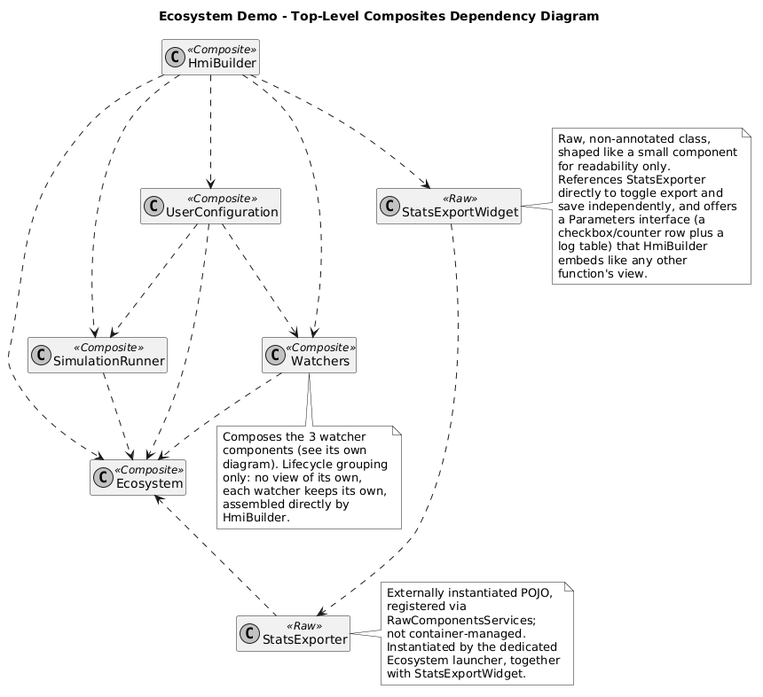
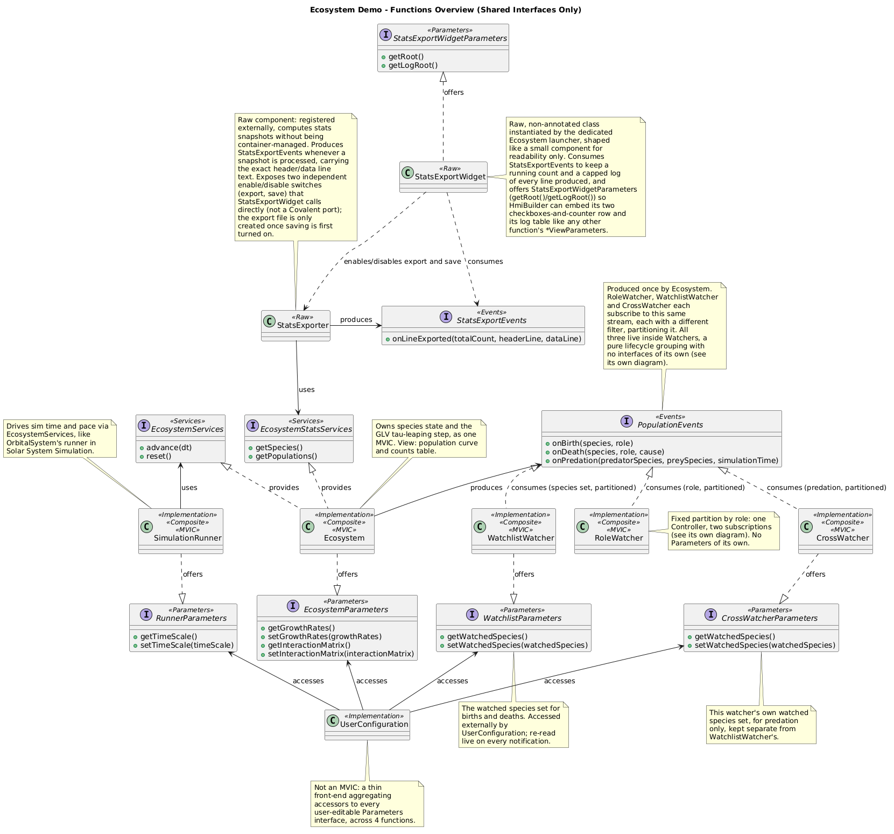
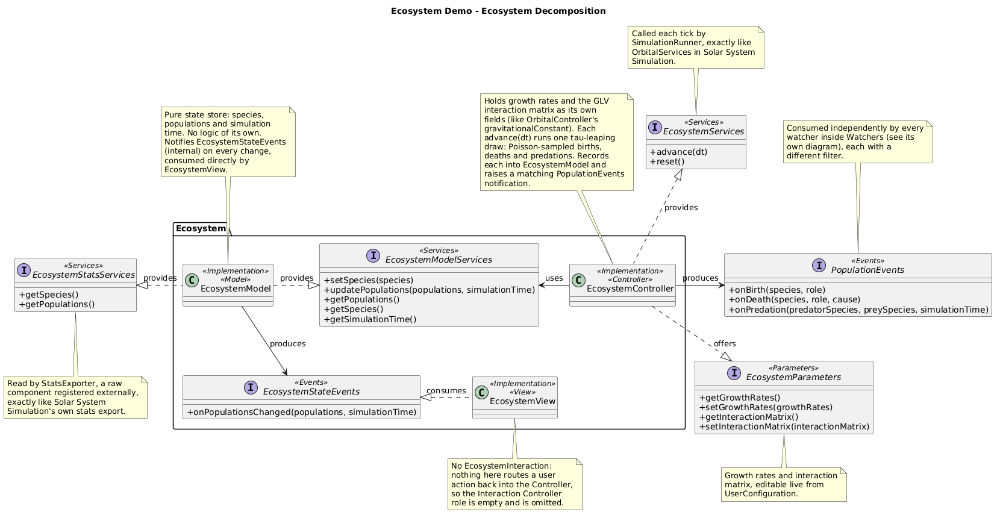
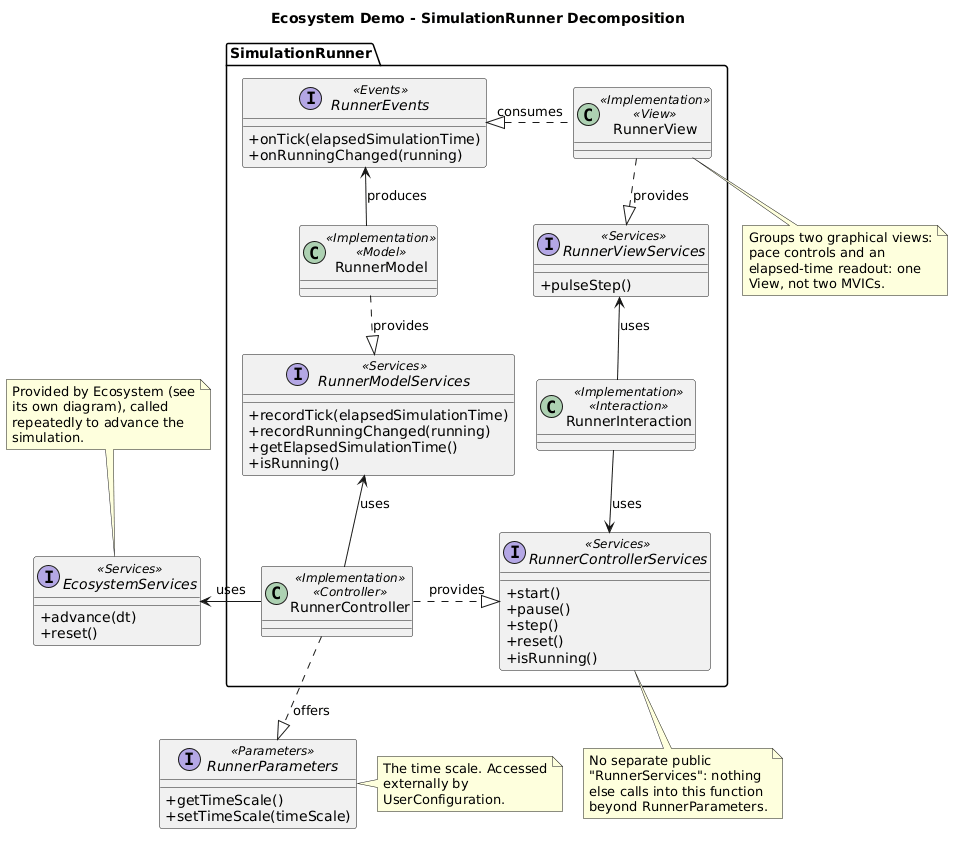
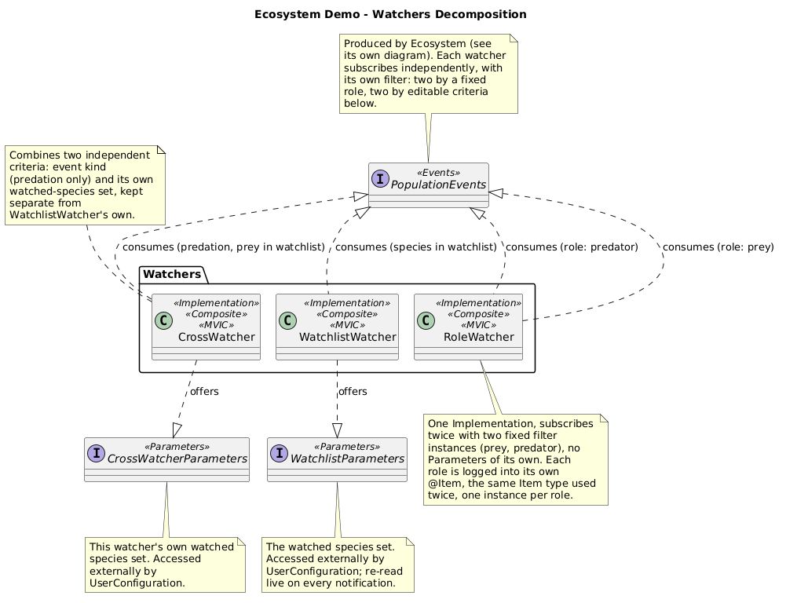
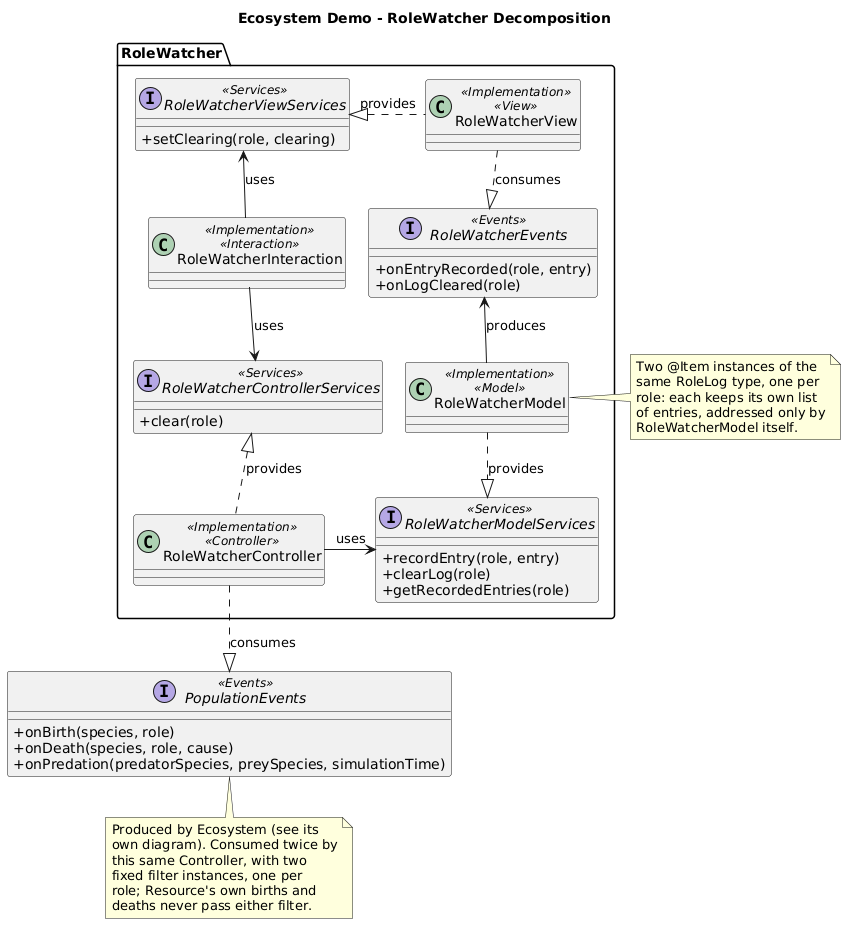
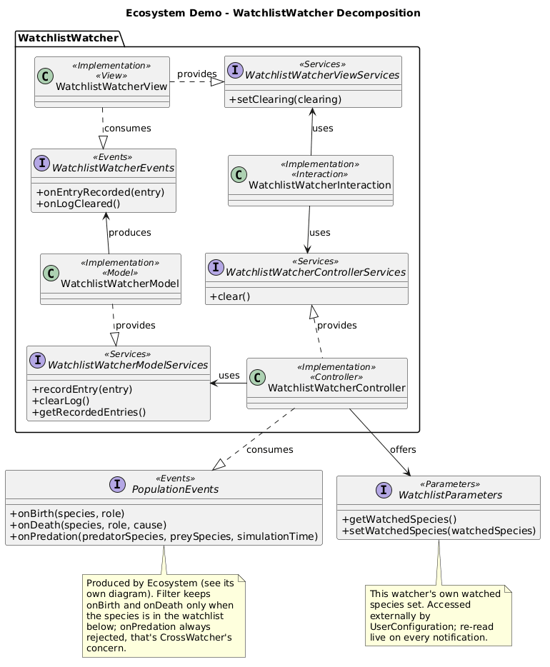
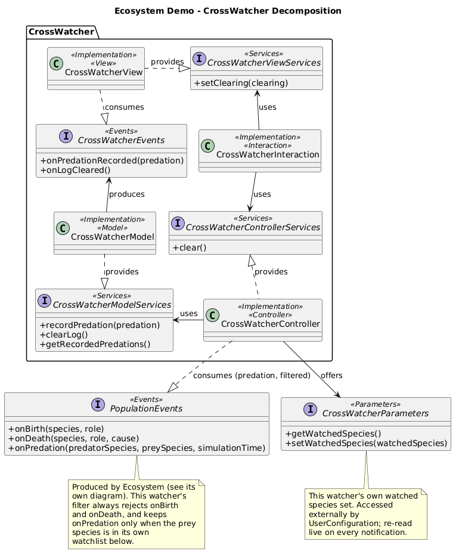
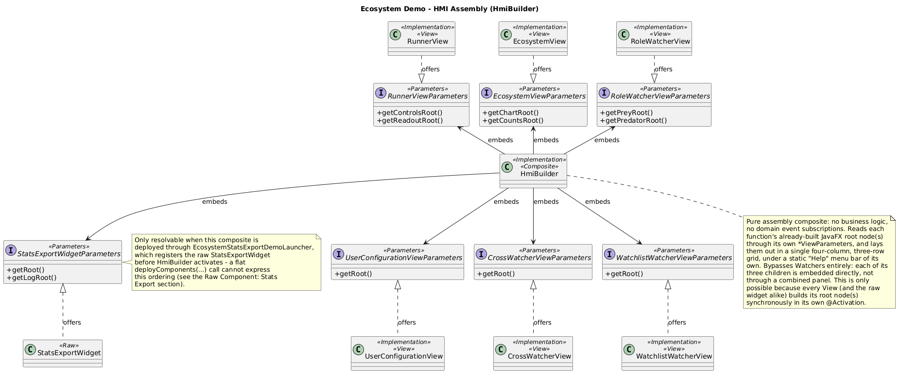

# Ecosystem - Architecture

<!-- doc-nav:top -->
[Home](../../../../README.md) | [Previous: Neural Network Trainer - Architecture](../neural-network-demonstration/index.md) | [Next: Rubik's Cube Solver - Architecture](../cube-solver-demonstration/index.md)
<!-- /doc-nav:top -->

# Table of Contents

- [Top-Level Composites](#top-level-composites)
- [Functions Overview](#functions-overview)
- [Per-Function Decomposition](#per-function-decomposition)
  - [Ecosystem](#ecosystem)
  - [SimulationRunner](#simulationrunner)
  - [Watchers](#watchers)
    - [RoleWatcher](#rolewatcher)
    - [WatchlistWatcher](#watchlistwatcher)
    - [CrossWatcher](#crosswatcher)
- [Raw Component: Stats Export](#raw-component-stats-export)
  - [A Deliberate Dependency Cycle](#a-deliberate-dependency-cycle)
- [HMI Assembly](#hmi-assembly)

This page is the architecture reference for the [Ecosystem](../../../examples.md#ecosystem)
demo: every top-level composite, how they depend on one another, the
interfaces shared between them, the internal MVIC decomposition of each
function, and how the HMI is assembled from all of it. It complements the
demo's entry in the [Examples Guide](../../../examples.md#ecosystem),
which covers what the demo does and how to use it - this page is about how
it is built.

# Top-Level Composites



Five composites: `Ecosystem`, `SimulationRunner`, `Watchers`,
`UserConfiguration` and `HmiBuilder`. These five are each a function's own
composite, at the top of its own MVIC - not the application's root; the
actual root composite is `EcosystemDemoImpl`, the only class passed to
`container.deployComponents(...)`, with every field activated in
declaration order: the HMI core first, then `Ecosystem` (owns the species
state and the simulation step), `SimulationRunner` (paces it), `Watchers`,
`UserConfiguration`, and `HmiBuilder` last, which reads every other
function's already-built view.

`Watchers` is a plain `@Implementation` with no `Services`, `Parameters` or
`Events` of its own - three more `@Implementation` fields
(`RoleWatcher`, `WatchlistWatcher`, `CrossWatcher`) and nothing else. It
exists purely to group their lifecycle under one parent, so
`EcosystemDemoImpl` activates and passivates all three together without
listing each one itself. [Composition](../../../managed-components.md#composition)
needs nothing extra to support this: a composite can contain composites
just as readily as it contains a Model or a View, so nesting one more
level costs nothing beyond declaring one more field - which is exactly
why "top-level composite" rather than "root component" is the right name
for `Ecosystem`, `SimulationRunner`, `Watchers`, `UserConfiguration` and
`HmiBuilder`: `RoleWatcher`, `WatchlistWatcher` and `CrossWatcher` are
composites too, just not top-level ones.

A `StatsExporter`/`StatsExportWidget` raw component pair sits alongside
these five, wired by the demo's own launcher rather than
`deployComponents(...)` - see [Raw Component: Stats
Export](#raw-component-stats-export) below.

# Functions Overview



One interface does almost all of the cross-function work:
`PopulationEvents`, produced once by `Ecosystem` and consumed
independently by all three components inside `Watchers`, each with its
own [filter](../../../managed-components.md#event-filters) - the same
broadcast stream partitioned three different ways, without any watcher
sorting events itself in its own callback. `EcosystemServices` (called
every tick by `SimulationRunner`) and the four `*Parameters` interfaces
`UserConfiguration` accesses round out the rest; `RoleWatcher` is the one
function with no `Parameters` of its own, since both of its filters are
fixed rather than user-editable.

`Ecosystem`'s Model also exposes `EcosystemStatsServices`
(`getSpecies()`, `getPopulations()`) as a second, read-only interface
alongside the state-mutating `EcosystemModelServices` the Controller
uses - deliberately public and separate, the shape the raw `StatsExporter`
component (see [Raw Component: Stats Export](#raw-component-stats-export)
below) consumes to read live population data without ever touching the
simulation itself.

# Per-Function Decomposition

Each function below is shown as its own MVIC, with full interface method
signatures, plus the public interfaces it exposes to or consumes from the
rest of the demo.

## Ecosystem



Owns species populations and the simulation step, as one MVIC - Model
and View only, no Interaction Controller, since nothing here routes a user
action back into the Controller. The Controller holds growth rates and a
generalized Lotka-Volterra interaction matrix as its own fields, and runs
one stochastic tau-leaping draw per `advance(dt)`: a Poisson-sampled
birth or death for each species, each recorded into the Model and raised
as a matching `PopulationEvents` notification.

```java
double lambda = Math.abs(netRate) * n * dt;
int count = poisson(lambda);
if (netRate >= 0.0) {
    nextPopulations.put(name, n + count);
    populationEvents.onBirth(name, s.role());
} else {
    double after = Math.max(0.0, n - count);
    nextPopulations.put(name, after);
    populationEvents.onDeath(name, s.role(), cause);
    firePredationIfApplicable(s, row);
}
```

Every non-`Grass` species starts with a *negative* baseline growth rate:
a `Prey` or `Predator` declines and eventually starves on its own, and
only turns net-positive through its interaction-matrix coefficient with
whatever it eats - without this, a species would keep growing even after
its own food source goes extinct.

Filtered subscription requires `PopulationEvents` to declare a subscribe
interface, `PopulationEventsSubscribe`, which each watcher consumes. The
container provides it: `EcosystemControllerImpl` does not implement it, as
it has no need to be told about its subscribers. Nothing needs catching up
there: `Watchers`' three components all activate before `Ecosystem` ever
produces a first event.

Between the Model and the View, `EcosystemStateEvents` is the opposite
case. The View subscribes manually, through `EcosystemStateEventsSubscribe`,
so that its "Pause display" checkbox can stop and resume its reception
while the simulation keeps running. The subscribe call carries two custom
arguments, neither a filter nor subscribe parameters: the simulation time
of the last state the View has, and the "History depth" it wants back
(entered in the field next to the checkbox):

```java
this.useStateEventsSubscribe.subscribe(this, this.subscribedSince, this.subscribedDepth);
```

`EcosystemModelImpl` implements the subscribe interface, so it is told
about each subscription ([event subscription delegation](../../../managed-components.md#event-subscription-delegation)).
It keeps a bounded history of the states it notified, and replays to the
new subscriber those after the given time, at most the latest `historyDepth`
of them: a long enough depth completes the curve at once, a short one
leaves a visible jump across the older missed part. The arguments identify
the subscription, so `unsubscribe` repeats them (see [Custom Event Subscription](../../../managed-components.md#custom-event-subscription)).
The pause involves no action: it only concerns this View, which handles it
itself.

## SimulationRunner



Paces the simulation independently of `Ecosystem`'s own logic, exactly
as `SimulationRunner` does in Solar System Simulation: its Controller
drives ticks from its own dedicated `ScheduledExecutorService` (a fixed
50 ms pause between ticks, about 20 ticks per second), the same
scheduled-executor shape `TrainingControllerImpl` uses in the neural network demo. Each tick
scales a fixed simulation-time step by the live, user-editable
`RunnerParameters.getTimeScale()` and calls `EcosystemServices.advance(dt)`.
The View groups two graphical views - run controls and an elapsed-time
readout - as one View, not two MVICs; a manual "Step" additionally
flashes the readout through `RunnerViewServices.pulseStep()`, visual
feedback a continuously-running tick doesn't need.

## Watchers



The lifecycle-only composite from [Top-Level
Composites](#top-level-composites) above, shown here with its three
children's boundary interfaces. Each one subscribes to the same
`PopulationEvents` stream produced by `Ecosystem`, with a filter that
picks out a disjoint (or, for `CrossWatcher`, cross-cutting) slice of
it - the three together are what turn one broadcast into three
differently-scoped views without `Ecosystem` knowing any of them exist.
`HmiBuilder` bypasses this composite entirely: each child's View is
embedded directly (see [HMI Assembly](#hmi-assembly) below), so grouping
them here is purely a lifecycle convenience, never a routing concern.

### RoleWatcher



One Controller, two independent subscriptions to the same
`PopulationEvents`, each combining a filter with
[subscribing an object instead of the consumer component](../../../managed-components.md#subscribing-an-object-instead-of-the-consumer-component):

```java
@Activation
public void subscribeBothRoles() {
    populationEventsSubscribe.subscribe(preyObserver, new RoleFilter(Role.PREY));
    populationEventsSubscribe.subscribe(predatorObserver, new RoleFilter(Role.PREDATOR));
}
```

`preyObserver` and `predatorObserver` are two small delegate instances of
a private inner class holding one fixed `Role` each, so the Controller's
own `onBirth`/`onDeath` never has to branch on which role a notification
belongs to - each delegate already knows. The architecture diagram still
shows one `consumes` edge: which Java object actually receives a given
callback is an implementation detail beneath that abstraction. The Model
mirrors this split with two `@Item` fields, `preyLog` and `predatorLog` -
necessarily two distinct item *types* (`PreyLogItem`, `PredatorLogItem`)
rather than one type used twice, since Covalent resolves an `@Item` field
by its declared type and two fields of the same type on one
`@Implementation` would collide.

### WatchlistWatcher



Subscribes itself directly, with a filter that reads this function's own
live `WatchlistParameters` on every notification - the same shape
`HazardAlertControllerImpl` uses in Solar System Simulation, so editing
the watched-species set from `UserConfiguration` changes what qualifies
from the next notification on, with no re-subscription needed.

### CrossWatcher



The one filter combining two independent criteria at once: event kind
(`onPredation` only - births and deaths are always filtered out) and,
within that, whether the prey species is in this function's own watched
set, kept deliberately separate from `WatchlistWatcher`'s own set of the
same shape. Two filter methods returning an unconditional `true` is what
expresses "not this watcher's concern" for an entire event kind, as
plainly as the third method's real condition expresses it for the one
kind this watcher does care about.

# Raw Component: Stats Export

A [raw component](../../../raw-components.md) pair, `StatsExporter` and
`StatsExportWidget`, mirrors the running population counts to a CSV file
from entirely outside the managed component graph: neither class carries
`@Component` or `@Implementation`, and neither is passed to
`deployComponents(...)`. Both are wired instead by
`EcosystemStatsExportDemoLauncher`, this demo's own `DemoLauncher`, which
the shared multi-demo launcher uses for the Ecosystem row in place of the
ordinary `ManagedDemoLauncher` every other demo uses.

`StatsExporter` [uses](../../../raw-components.md#use-services)
`EcosystemStatsServices` from the outside, through two independent
switches rather than one: `setExportEnabled(boolean)` turns computing one
population snapshot a second - and logging it - on or off, and
`setSaveEnabled(boolean)` separately turns persisting those same snapshots
to a CSV file on or off:

```java
private void tick() {
    if (!this.exportEnabled) {
        return;
    }
    List<Species> species = this.useEcosystemStatsServices.getSpecies();
    Map<String, Double> populations = this.useEcosystemStatsServices.getPopulations();

    boolean headerIsNew = this.headerText == null;
    if (headerIsNew) {
        this.headerText = species.stream().map(Species::name).collect(Collectors.joining(","));
    }
    String dataText = species.stream().map(s -> String.valueOf(populations.getOrDefault(s.name(), 0.0)))
            .collect(Collectors.joining(","));

    if (this.saveEnabled) {
        try {
            this.appendToFile(dataText);
        } catch (IOException e) {
            throw new UncheckedIOException(e);
        }
    }

    this.totalCount++;
    this.producedEvents.onLineExported(this.totalCount, headerIsNew ? this.headerText : null, dataText);
}
```

The export file itself is only ever created the first time saving turns
on, never merely because export is enabled - a user who only watches the
log never gets a file on disk they did not ask for. `StatsExporter`
[produces](../../../raw-components.md#produce-events) a raw
`StatsExportEvents.onLineExported(int totalCount, String headerLine, String dataLine)`
notification on every tick, carrying the exact header and data line text -
`headerLine` is non-null only the first time it is produced - so a raw
consumer can display a verbatim running log without reading the export
file back off disk.

`StatsExportWidget` is the raw counterpart on the consuming side: it
[subscribes](../../../raw-components.md#subscribe-to-events) to
`StatsExportEvents` to keep a running line count and a log of every header
and data line produced, capped at 200 rows, holds a plain object reference
to `StatsExporter` to flip its two switches directly (a raw component
calling another raw component needs no Covalent port at all), and
[offers](../../../raw-components.md#offer-and-access-parameters)
`StatsExportWidgetParameters` the same way every managed function's own
View offers its `*ViewParameters` - two accessors, `getRoot()` for the
checkbox-and-counter row and `getLogRoot()` for the log table, so
`HmiBuilder` embeds both through the ordinary `@AccessedParameters` +
`getXxxRoot()` pattern without knowing its offeror is raw.

Wiring order is what makes this work, and `EcosystemStatsExportDemoLauncher`
owns it entirely - `LauncherApplication` itself never imports anything
Ecosystem-specific: the widget registers and offers its parameters first,
so `HmiBuilder` resolves it like any other `*ViewParameters` once it
activates; the managed `EcosystemDemoImpl` composite then deploys and
starts; only once `Ecosystem` has activated and published
`EcosystemStatsServices` does `StatsExporter` register and start pulling
from it. A flat list of `@Implementation` classes handed to
`deployComponents(...)` cannot express this sequencing, which is exactly
why this demo needs its own `DemoLauncher` rather than the shared
launcher's ordinary one.

## A Deliberate Dependency Cycle

The Supervisor's dependency graph reports one cycle in this demo, and it
is a real one:

- `StatsExportWidget` depends on `StatsExporter`: it consumes
  `StatsExportEvents`.
- `StatsExporter` depends on `EcosystemDemo`: it uses
  `EcosystemStatsServices`, provided by `Ecosystem` inside it.
- `EcosystemDemo` depends on `StatsExportWidget`: `HmiBuilder`, inside it,
  accesses `StatsExportWidgetParameters`.

Dependencies are analyzed between top-level components, and a composite
stands for everything it contains. The two raw components cannot be
composed into `EcosystemDemo`, so they sit beside it at the top level,
and the dependencies running into and out of the composite close the loop.
Taken component by component, the chain itself is linear: `HmiBuilder`
→ `StatsExportWidget` → `StatsExporter` → `Ecosystem`.

The demo still runs, because the launcher orders the wiring by hand (see
above) and a used port waits on a surrogate until its provider appears.

The fix would be to turn both raw components into managed components and
compose them into `EcosystemDemo`: there would then be a single top-level
component, and its children would only form a linear chain. The cycle is
kept on purpose, since this pair exists to show raw components in use,
and it also shows what the cycle detection reports when components
outside a composite depend on it in both directions.

# HMI Assembly



`HmiBuilder` reads seven `*ViewParameters` interfaces -
`Ecosystem`, `SimulationRunner`, `UserConfiguration`, each of the three
watchers individually, and the raw `StatsExportWidgetParameters` - laid
out in a grid of three columns and one row. The left column holds the
configuration and the runner controls. The center column holds the
population chart, which takes the spare height, above the population counts
table and the elapsed-time readout. The right column holds the watchlist
table, the prey log, the predator log and the cross-watcher table, followed
by the stats export widget's two nodes stacked - `getRoot()` above
`getLogRoot()`. `EcosystemViewParameters` offers two separate root nodes,
`getChartRoot()` and `getCountsRoot()`, for the same reason
`RunnerViewParameters` splits into `getControlsRoot()` and
`getReadoutRoot()`.

The grid's own width is pinned at the lesser of 1920 pixels and the
screen's visual width, with the center column's minimum width pinned at
zero: left at its default, a column's minimum is derived from its children's
natural size and could otherwise force the grid wider than the cap - the
population chart is exactly the kind of child that would do this. With the
center column free to shrink, each table still fills its own cell at full
width through its own `CONSTRAINED_RESIZE_POLICY`,
so nothing in this assembly ever renders wider than the window actually
is.

As in the other demos, this composite is otherwise pure assembly - no
business logic, no domain event subscriptions - and only works because
every View (and the raw widget alike) builds its root node(s)
synchronously, before `HmiBuilder` activates and reads these parameters;
`StatsExportWidgetParameters` is only resolvable here because
`EcosystemStatsExportDemoLauncher` registers the widget before the
managed composite deploys, exactly as the previous section describes.

`HmiBuilder` also wires one piece of code of its own, beyond assembly: a
static "Help" menu bar, with an "About Ecosystem Demo" entry summarizing
what the demo does and which Covalent mechanisms it illustrates, and a
"Using Ecosystem Demo" entry describing its controls - each opening a
small, non-modal, read-only text window, wired directly rather than
through `ActionConsumerServices`, exactly as in the other three demos
(see [Neural Network Trainer - Architecture](../neural-network-demonstration/index.md#hmi-assembly)).
Ecosystem has no "View" menu of its own - that addition is specific to
Solar System Simulation's dark/light theme switch (see [Solar System Simulation - Architecture](../solar-system-demonstration/index.md#hmi-assembly)).

<!-- doc-nav:bottom -->
[Home](../../../../README.md) | [Previous: Neural Network Trainer - Architecture](../neural-network-demonstration/index.md) | [Next: Rubik's Cube Solver - Architecture](../cube-solver-demonstration/index.md)
<!-- /doc-nav:bottom -->
