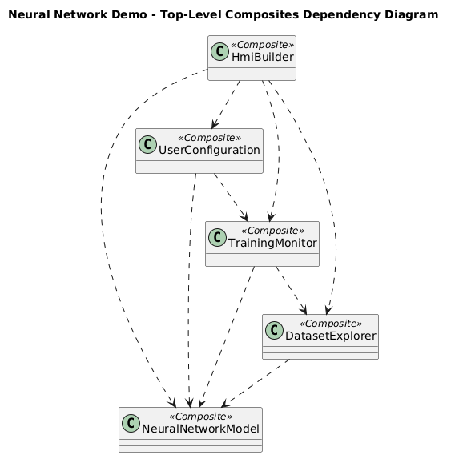
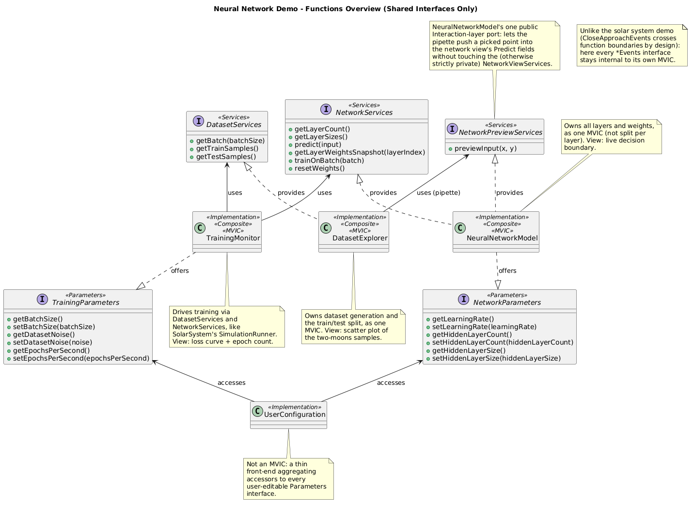
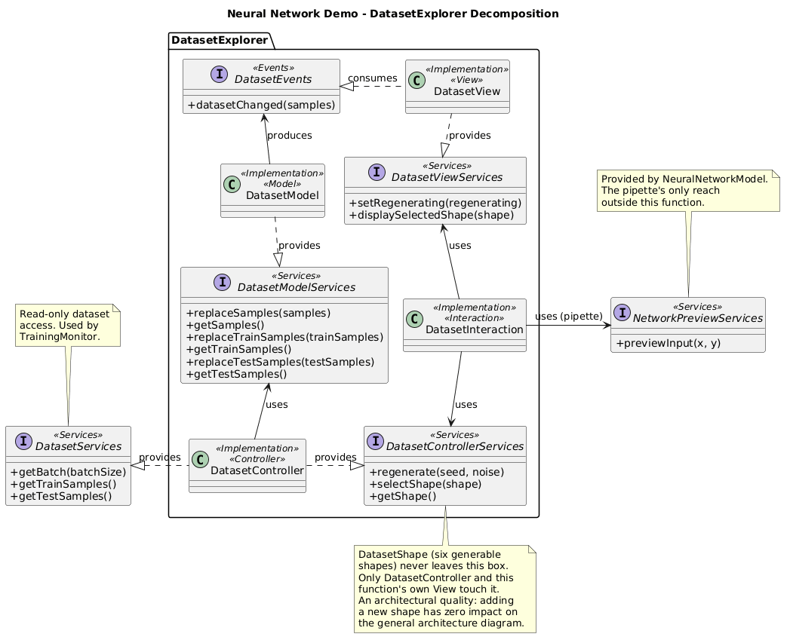
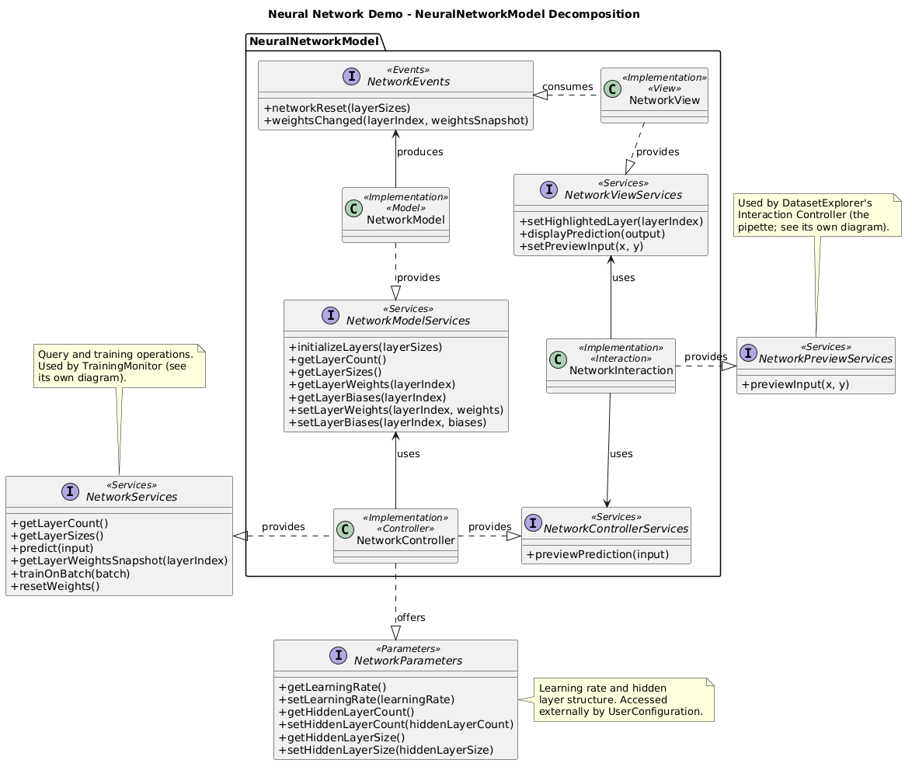
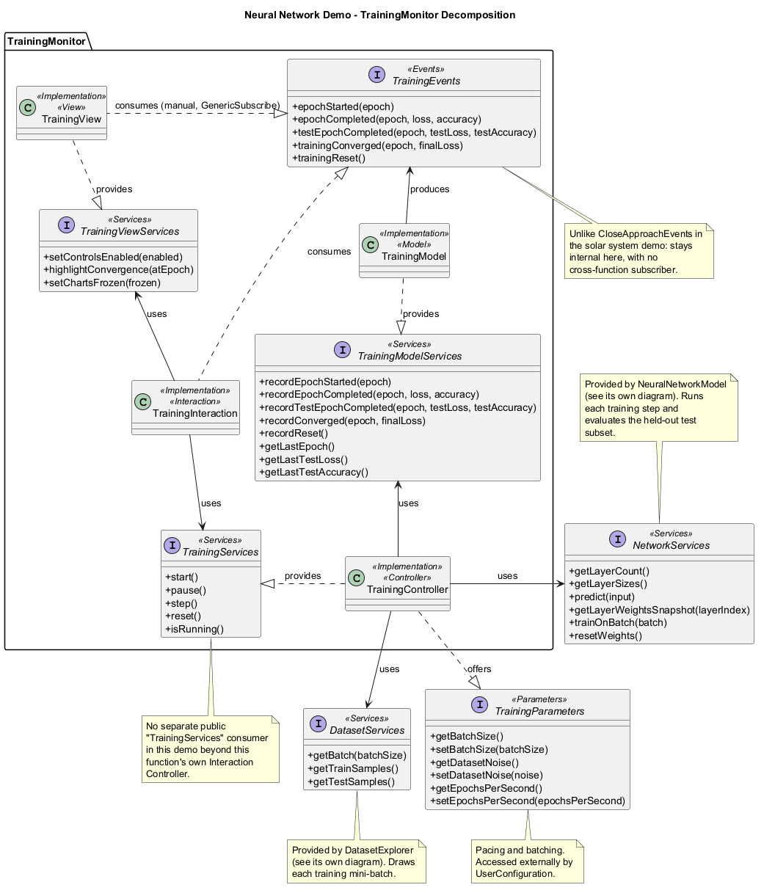
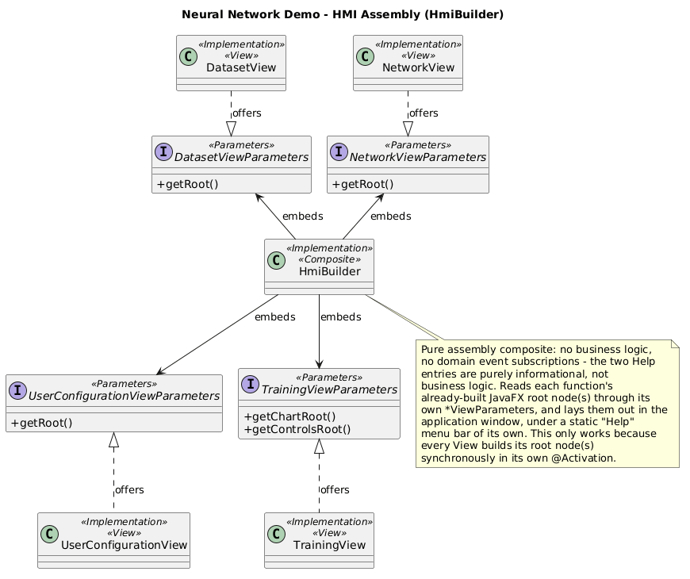

# Neural Network Trainer - Architecture

<!-- doc-nav:top -->
[Home](../../../../README.md) | [Previous: Solar System Simulation - Architecture](../solar-system-demonstration/index.md) | [Next: Ecosystem - Architecture](../ecosystem-demonstration/index.md)
<!-- /doc-nav:top -->

# Table of Contents

- [Top-Level Composites Dependency Diagram](#top-level-composites-dependency-diagram)
- [Functions Overview](#functions-overview)
- [Per-Function Decomposition](#per-function-decomposition)
  - [DatasetExplorer](#datasetexplorer)
  - [NeuralNetworkModel](#neuralnetworkmodel)
  - [TrainingMonitor](#trainingmonitor)
- [HMI Assembly](#hmi-assembly)

This page is the architecture reference for the [Neural Network Trainer](../../../examples.md#neural-network-trainer) demo: every root
component, how they depend on one another, the interfaces shared between
them, the internal MVIC decomposition of each function, and how the HMI is
assembled from all of it. It complements the demo's entry in the [Examples Guide](../../../examples.md#neural-network-trainer), which covers what the
demo does and how to use it - this page is about how it is built.

# Top-Level Composites Dependency Diagram

Five [composites](../../../managed-components.md#composition):
`DatasetExplorer`, `NeuralNetworkModel`, `TrainingMonitor`,
`UserConfiguration` and `HmiBuilder`. `NeuralNetworkModel` is the only one
every other function depends on - it owns the network's layers and weights,
and everything else either trains it, previews into it, or configures it.
`TrainingMonitor` depends on both `DatasetExplorer` and `NeuralNetworkModel`
to actually run training; `UserConfiguration` depends on `NeuralNetworkModel`
and `TrainingMonitor` for the parameters it exposes; `HmiBuilder` depends on
all four others - it is the composition root, built last, that assembles the
whole window.

These five are each a function's own composite, at the top of its own
MVIC - not the application's root. All five, plus `HmiCore`, are declared
as `@Implementation` fields inside `NeuralNetworkDemoImpl`, the demo's
actual [root composite](../../../glossary.md#root-composite) and the only
class the launcher passes to `deployComponents(...)`. Composition can nest
to any depth - each function's own composite is itself made of its MVIC
parts - and activation/passivation both proceed children-before-parent, in
field-declaration order, at every level: the launcher never sequences a
function by hand, it deploys one class and calls `start()`/`stop()`.

# Functions Overview

The interfaces that actually cross function boundaries, in one place. Three
of the five root composites are full
[MVICs](../../../glossary.md#mvic) (Model / Controller / Interaction Controller
/ View); `UserConfiguration` is deliberately not one - as in the solar
system demo, it has no Model or Controller of its own, only an Interaction
Controller that reaches directly into other functions' `Parameters`
interfaces.

Unlike the solar system demo, where `CloseApproachEvents` crosses function
boundaries by design, every `*Events` interface here stays internal to its
own MVIC. A `Services` interface (`DatasetServices`, `NetworkServices`) is
what a function exposes to another one instead - plus one narrow exception,
`NetworkPreviewServices`: `NeuralNetworkModel`'s single public
Interaction-layer port, reached by `DatasetExplorer`'s own Interaction
Controller so its canvas "pipette" can push a picked point into the
network's Predict fields, without touching anything else about
`NeuralNetworkModel`.

# Per-Function Decomposition

Each function below is shown as its own MVIC, with full interface method
signatures, plus the public interfaces it exposes to or consumes from the
rest of the demo.

## DatasetExplorer

Owns dataset generation and the train/test split, as one MVIC - not one
component per shape. Six interchangeable generator strategies (two moons,
ring, cross, star, spiral, checkerboard) sit behind a single map lookup in
the Controller: adding a shape means adding one generator and one map
entry, nothing else in this function - the public/internal services split
included - needs to know a new shape exists. `DatasetControllerServices` is
this function's own Interaction Controller's view onto it; `DatasetServices` is
the public, read-only export `TrainingMonitor` draws each mini-batch from.

## NeuralNetworkModel

Owns every layer and weight as a single MVIC - not one component per layer.
It exposes three separate interfaces for three separate audiences:
`NetworkServices` for `TrainingMonitor` to train and evaluate,
`NetworkParameters` for `UserConfiguration` to tune the learning rate and
hidden-layer structure, and `NetworkPreviewServices` for `DatasetExplorer`'s
pipette. A fourth parameters interface, `OptimizerParameters`, configures
which gradient-descent strategy the Controller uses - but it is offered by
an internal `@Item`, not the Controller itself, and deliberately kept
private to this function: no other MVIC needs to reach it, so it does not
appear on the Functions Overview diagram at all, the same architectural
discipline that keeps `DatasetShape` out of it.

## TrainingMonitor

Drives training by calling `NetworkServices.trainOnBatch(...)` batch by
batch over the training subset, the same role the solar system demo's
`SimulationRunner` plays through `OrbitalSystemServices`. Every epoch also
evaluates the same, unchanged network on the held-out test subset through a
pure `NetworkServices.predict(...)` forward pass, so the test-loss curve
genuinely reveals overfitting rather than reflecting anything the training
loop itself touched. A configurable convergence threshold pauses training
automatically once the average loss drops low enough.

# HMI Assembly

The one mechanism the per-function diagrams above cannot show on their own:
how the four Views end up laid out in a single window. Each View exposes
its own `*ViewParameters` interface - a settled JavaFX node, or two for
`TrainingView`'s split chart/controls - and `HmiBuilder` is the sole
consumer of all four, reading each one through `@AccessedParameters` rather
than `@UsedServices`, matching every `getRoot()`-style accessor's own
choice to be modeled as a parameter rather than a service. `HmiBuilder` is
a pure assembly composite: no business logic, no domain event
subscriptions - its one piece of code of its own is a static "Help" menu,
wired directly rather than through `ActionConsumerServices`, since a dialog
with nothing to implement gains nothing from that indirection. This only
works because every View builds its root node(s) synchronously in its own
`@Activation`, so by the time `HmiBuilder` activates and reads the
parameters, every root node already exists.

<!-- doc-nav:bottom -->
[Home](../../../../README.md) | [Previous: Solar System Simulation - Architecture](../solar-system-demonstration/index.md) | [Next: Ecosystem - Architecture](../ecosystem-demonstration/index.md)
<!-- /doc-nav:bottom -->
