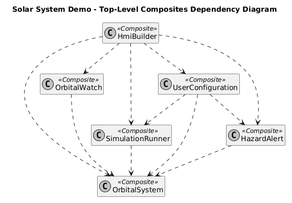
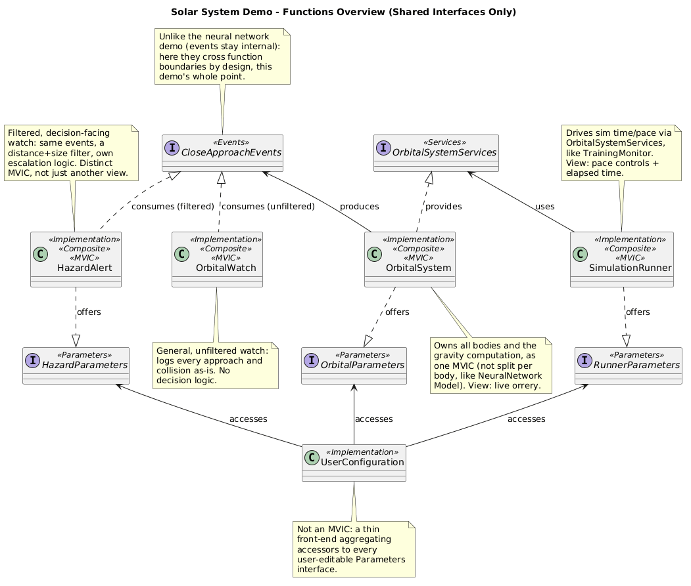
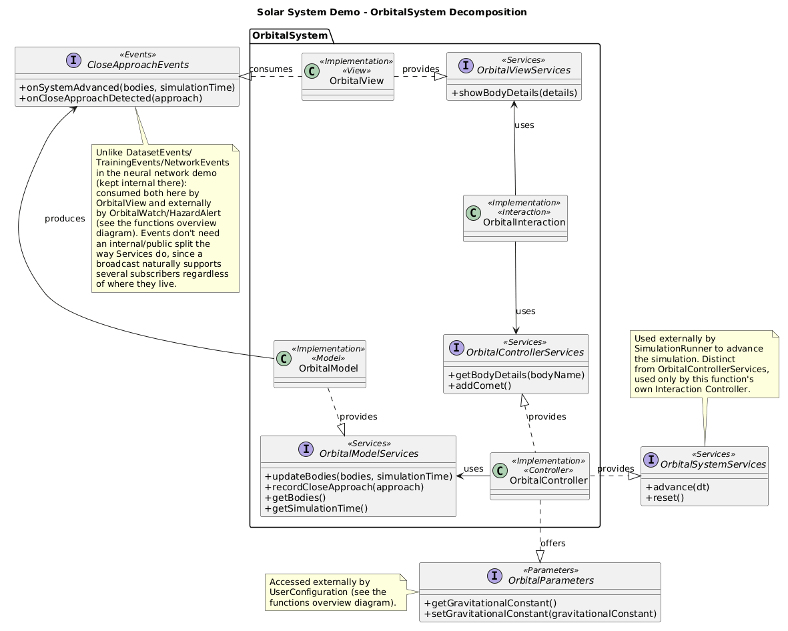
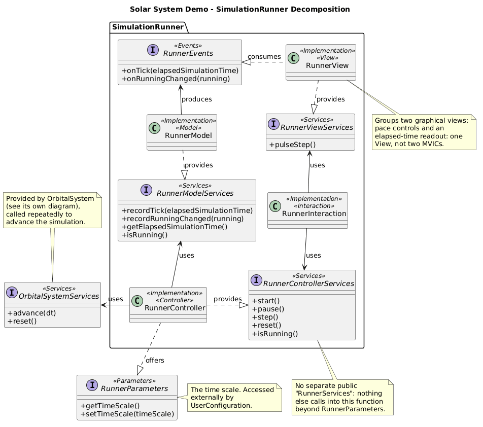
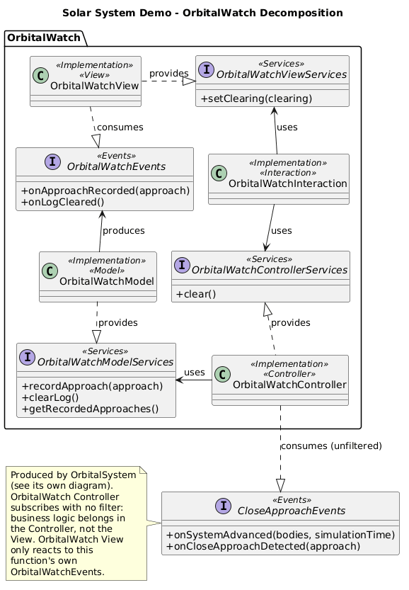
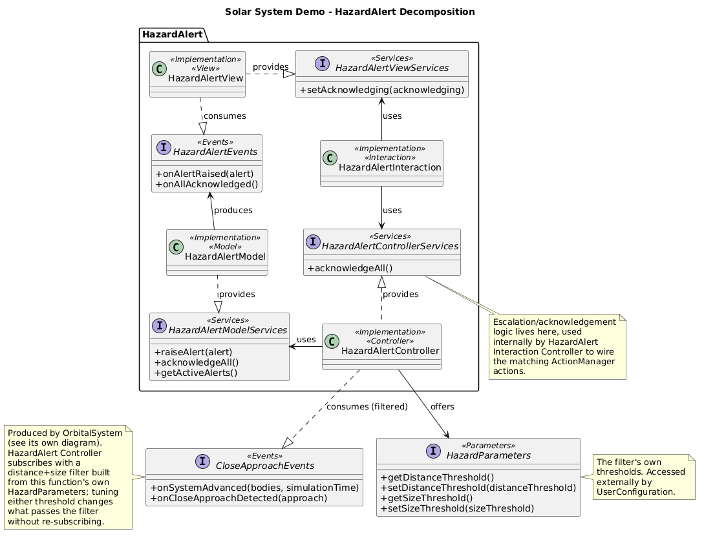
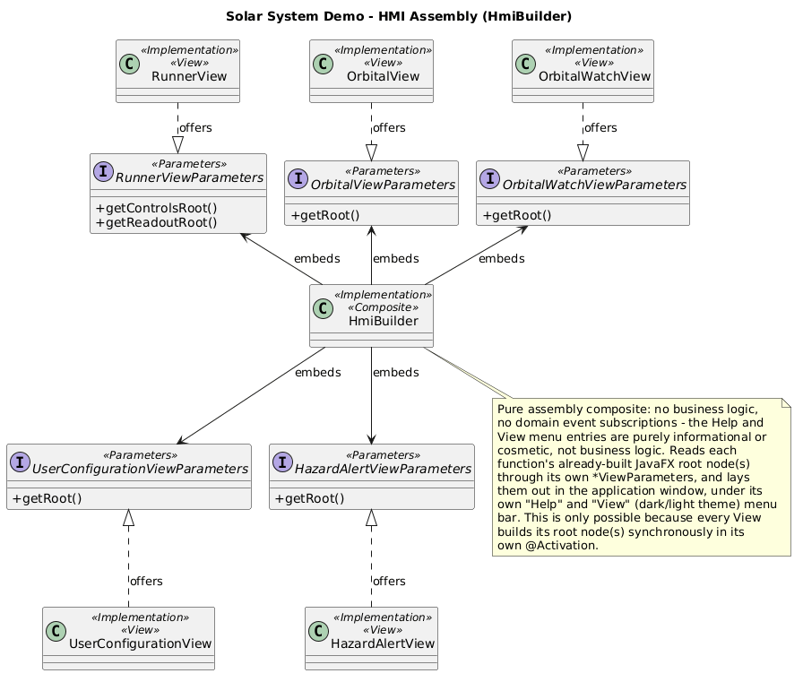

# Solar System Simulation - Architecture

<!-- doc-nav:top -->
[Home](../../../../README.md) | [Previous: Covalent Examples Guide](../../../examples.md) | [Next: Neural Network Trainer - Architecture](../neural-network-demonstration/index.md)
<!-- /doc-nav:top -->

# Table of Contents

- [Top-Level Composites Dependency Diagram](#top-level-composites-dependency-diagram)
- [Functions Overview](#functions-overview)
- [Per-Function Decomposition](#per-function-decomposition)
  - [OrbitalSystem](#orbitalsystem)
  - [SimulationRunner](#simulationrunner)
  - [OrbitalWatch](#orbitalwatch)
  - [HazardAlert](#hazardalert)
- [HMI Assembly](#hmi-assembly)

This page is the architecture reference for the [Solar System Simulation](../../../examples.md#solar-system-simulation) demo: every root
component, how they depend on one another, the interfaces shared between
them, the internal MVIC decomposition of each function, and how the HMI is
assembled from all of it. It complements the demo's entry in the [Examples Guide](../../../examples.md#solar-system-simulation), which covers what the
demo does and how to use it - this page is about how it is built.

# Top-Level Composites Dependency Diagram



Six [composites](../../../managed-components.md#composition):
`OrbitalSystem`, `SimulationRunner`, `OrbitalWatch`, `HazardAlert`,
`UserConfiguration` and `HmiBuilder`. `OrbitalSystem` is the only one every
other function depends on - it owns the bodies and the gravity computation
that everything else either drives, watches or displays.
`UserConfiguration` depends on three functions at once (`OrbitalSystem`,
`SimulationRunner`, `HazardAlert`), and `HmiBuilder` on all five others: it
is the composition root, built last, that assembles the whole window. The
technical `HmiCore` component is left out of this diagram on purpose - it
carries no domain meaning.

These six are each a function's own composite, at the top of its own MVIC -
not the application's root. All six, plus `HmiCore`, are declared as
`@Implementation` fields inside `SolarSystemDemoImpl`, the demo's actual
[root composite](../../../glossary.md#root-composite) and the only class
the launcher passes to `deployComponents(...)`. Activation and passivation
both proceed children-before-parent, in field-declaration order: the
launcher never sequences a function by hand, it deploys one class and
calls `start()`/`stop()`.

# Functions Overview



The interfaces that actually cross function boundaries, in one place. Four
of the six root composites are full
[MVICs](../../../glossary.md#mvic) (Model / Controller /
Interaction Controller / View); `UserConfiguration` is deliberately not one - it
has no Model or Controller of its own, only an Interaction Controller that
accesses other functions' `Parameters` interfaces directly, and a View.

The centerpiece is `CloseApproachEvents`, produced once by `OrbitalSystem`
and consumed by two different functions in two different ways - detailed
further down. Unlike the neural network demo, where events stay internal
to their own function, this demo uses events across function boundaries by
design; a `Services` interface (`OrbitalSystemServices`) still exists
alongside it wherever a function needs to reach into another and get
something back, rather than just be notified.

# Per-Function Decomposition

Each function below is shown as its own MVIC, with full interface method
signatures, plus the public interfaces it exposes to or consumes from the
rest of the demo.

## OrbitalSystem



Owns every body and the gravity integration as a single MVIC - not one
component per body. It exposes three separate interfaces for three
separate audiences: `OrbitalControllerServices` for its own Interaction
Controller only, `OrbitalSystemServices` for `SimulationRunner` to advance
the simulation, and `OrbitalParameters` for `UserConfiguration` to tune the
gravitational constant. `CloseApproachEvents` is produced here and is the
one interface in the whole demo that does not need an internal/public
split: a broadcast naturally supports several subscribers, wherever they
live, without the provider needing to know who they are.

## SimulationRunner



Drives the simulation's time and pace by calling
`OrbitalSystemServices.advance(dt)` repeatedly, exposing start/pause/step/
reset through `RunnerControllerServices` and the current time scale through
`RunnerParameters`. Its View groups two graphical panels - pace controls
and an elapsed-time readout - as one View, not two: grouping is a View
concern, not a reason to split the MVIC.

## OrbitalWatch



A general, unfiltered log of every close approach the simulation detects.
Its Controller subscribes to `CloseApproachEvents` with no filter at all -
logging everything as-is is exactly the point, and there is no distance or
size logic to speak of.

## HazardAlert



Watches the same `CloseApproachEvents` stream as `OrbitalWatch`, but
subscribes with an [event filter](../../../managed-components.md#event-filters)
built from its own `HazardParameters` (distance and size thresholds). This
is the demo's clearest illustration of what a filter is for: two
independent consumers seeing different subsets of one broadcast, with
neither one filtering events itself in its own callback, and the filter
re-reading the live threshold on every notification - moving a slider
changes what qualifies from the next close approach on, with no
re-subscription needed.

`OrbitalWatch` and `HazardAlert` both consume `CloseApproachEvents`, but not
the same way. `OrbitalWatch` just implements the interface - managed
autowiring subscribes it, unfiltered:

```java
public class OrbitalWatchControllerImpl implements OrbitalWatchController,
        OrbitalWatchControllerServices, CloseApproachEvents {
    @Override
    public void onCloseApproachDetected(CloseApproach approach) {
        this.useOrbitalWatchModelServices.recordApproach(approach);
    }
}
```

`HazardAlert` subscribes itself manually, through the events interface's
subscribe interface, passing a filter built from its own live `HazardParameters`:

```java
@UsedEventsSubscribe
private CloseApproachEvents.CloseApproachEventsSubscribe useCloseApproachEventsSubscribe;

@Activation
public void subscribeFiltered() {
    this.useCloseApproachEventsSubscribe.subscribe(this, new HazardFilter());
}
```

# HMI Assembly



The one mechanism the per-function diagrams above cannot show on their
own: how the five Views end up laid out in a single window. Each View
exposes its own `*ViewParameters` interface - a `getRoot()` accessor to the
JavaFX node(s) it already built - and `HmiBuilder` is the sole consumer of
all five. `HmiBuilder` is a pure assembly composite: no business logic, no
domain event subscriptions, nothing but reading each function's
already-built root node(s) and arranging them in the application window.
This only works because every View builds its root node(s) synchronously
in its own `@Activation`, so by the time `HmiBuilder` activates and reads
the parameters, every root node already exists.

`HmiBuilder` also wires two pieces of code of its own, beyond assembly: a
static "Help" menu, with an "About Solar System Simulation" entry
summarizing what the demo does and which Covalent mechanisms it
illustrates, and a "Using Solar System Simulation" entry describing its
controls - exactly as in the other three demos (see [Neural Network Trainer - Architecture](../neural-network-demonstration/index.md#hmi-assembly));
and a "View" menu of two mutually exclusive `RadioMenuItem`s, swapping the
whole scene's stylesheet between a dark theme (the default) and a light
one - the one menu unique to this demo.

<!-- doc-nav:bottom -->
[Home](../../../../README.md) | [Previous: Covalent Examples Guide](../../../examples.md) | [Next: Neural Network Trainer - Architecture](../neural-network-demonstration/index.md)
<!-- /doc-nav:bottom -->
