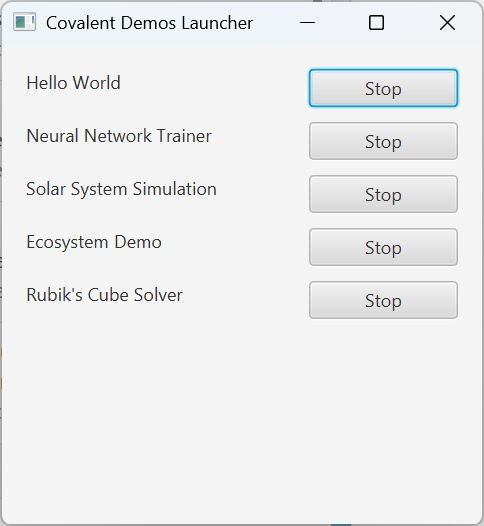
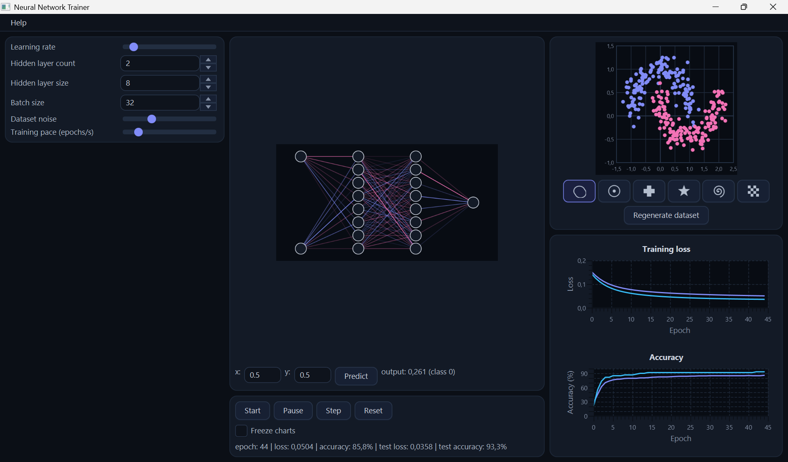
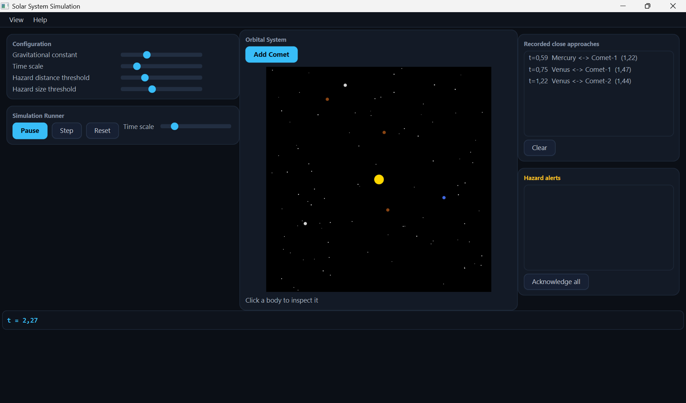
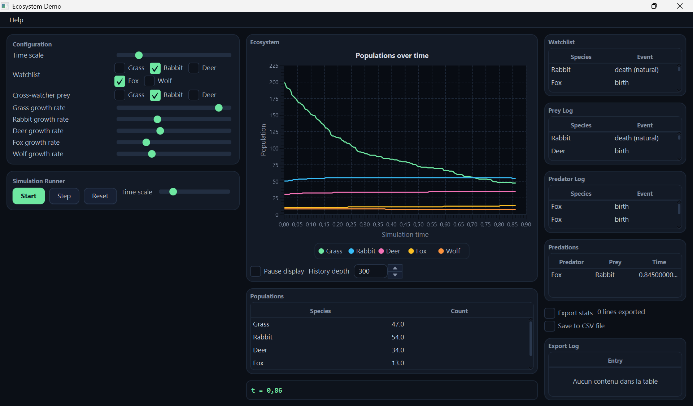
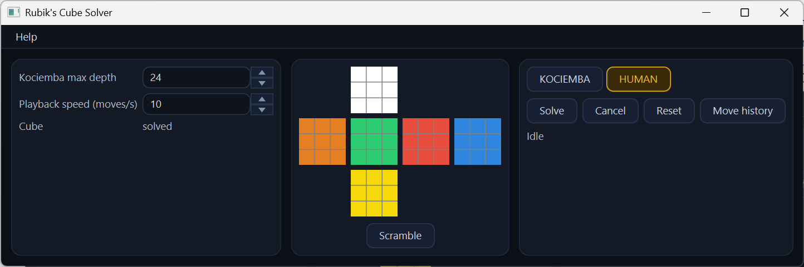

# Covalent Examples Guide

<!-- doc-nav:top -->
[Home](../README.md) | [Previous: Covalent HMI Guide](hmi.md) | [Next: Solar System Simulation - Architecture](architecture/examples/solar-system-demonstration/index.md)
<!-- /doc-nav:top -->

# Table of Contents

- [Covalent Examples](#covalent-examples)
  - [The MVIC Pattern](#the-mvic-pattern)
- [Capability Matrix](#capability-matrix)
- [Neural Network Trainer](#neural-network-trainer)
  - [What NNTrainer Does](#what-nntrainer-does)
  - [Using NNTrainer](#using-nntrainer)
  - [Covalent Capabilities In NNTrainer](#covalent-capabilities-in-nntrainer)
- [Solar System Simulation](#solar-system-simulation)
  - [What Solar System Simulation Does](#what-solar-system-simulation-does)
  - [Using Solar System Simulation](#using-solar-system-simulation)
  - [Covalent Capabilities In Solar System Simulation](#covalent-capabilities-in-solar-system-simulation)
- [Ecosystem](#ecosystem)
  - [What Ecosystem Does](#what-ecosystem-does)
  - [Using Ecosystem](#using-ecosystem)
  - [Covalent Capabilities In Ecosystem](#covalent-capabilities-in-ecosystem)
- [Rubik's Cube Solver](#rubiks-cube-solver)
  - [What Rubik's Cube Solver Does](#what-rubiks-cube-solver-does)
  - [Using Rubik's Cube Solver](#using-rubiks-cube-solver)
  - [Covalent Capabilities In Rubik's Cube Solver](#covalent-capabilities-in-rubiks-cube-solver)

# Covalent Examples

> **A note on the examples.** The examples are there to show how Covalent is used.
> They, and the algorithms they run (the training, the solver, the simulations), were
> written with the help of an AI assistant, and are not meant as reference
> implementations of those algorithms. The component structure, the ports and the use
> of the container are what they illustrate.

`covalent-examples` hosts a handful of small, runnable JavaFX applications
built entirely on Covalent. Each one leans into a different subset of the
framework's mechanisms rather than showcasing every feature at once, and
each is launched from a single entry point, `LauncherApplication`:

```powershell
mvn -f covalent-examples/pom.xml -am -DskipTests javafx:run
```

With the Maven Wrapper (see [Building And Testing The Repository](../README.md#building-and-testing-the-repository) for it and for
the required JDK version), use `.\mvnw.cmd` on Windows and `./mvnw` elsewhere
in place of `mvn`. Add `-Pjmx` to let a JMX tool connect to the JVM that runs
the examples (`localhost:9010`, or the next free port; see
[Connecting a JMX Tool to the Application](configuration.md#connecting-a-jmx-tool-to-the-application)).

This opens a small launcher window with one button per demo. Each demo runs
in its own, independently started and stopped `CovalentContainer`, obtained
through `Covalent.managedContainer(name)`, so several can run side by side
without interfering with one another, and stopping one leaves the others
untouched. The [supervisor](supervision.md#covalent-supervision) is
available alongside every demo: press <kbd>Ctrl</kbd>+<kbd>Shift</kbd>+<kbd>F12</kbd>
in any demo window to open it and inspect the live component graph while the demo
runs (see [Summoning the Supervisor](supervision.md#summoning-the-supervisor)).



Every demo window also carries its own "Help" menu, with "About" and
"Using" entries that each open a small, non-modal, read-only panel -
one summarizing what that demo illustrates and which Covalent mechanisms
it uses, the other describing how to drive its controls. Built by each
demo's own `HmiBuilder` alongside everything else it assembles, this is
the one piece of HMI code in every demo that is not itself an MVIC.

## The MVIC Pattern

Every demo function is built the same way: Model / Controller / Interaction
Controller / View (MVIC), one instance per function, as a single
[composite](managed-components.md#composition) grouping the four.

- The **Model** holds the function's state and produces its
  [events](managed-components.md#events) - no logic beyond deciding when
  something changed.
- The **Controller** holds the actual logic: it reacts to
  [services](managed-components.md#services) calls and to events, and drives
  the Model.
- The **Interaction Controller** is the only component that registers the
  function's user-triggered actions with the HMI's
  [ActionManager](hmi.md#actionmanager)
  (`ActionProviderServices.registerActionExecution`).
- The **View** renders the Model's state and triggers actions by
  [ActionKey](hmi.md#actionmanager) (`ActionConsumerServices.executeAction`)
  - it never calls the Interaction Controller directly.

This keeps all four genuinely independent: the Model doesn't know a View
exists, and the View doesn't know which component ends up handling an action
it triggers.

# Capability Matrix

Four demos make up this module, each leaning into a different subset of
Covalent's mechanisms. The matrix shows which of them each one actually
demonstrates - not which ones it merely could.

| Capability | Neural Network Trainer | Solar System Simulation | Ecosystem | Rubik's Cube Solver |
| --- | --- | --- | --- | --- |
| [Services](managed-components.md#services) | ✅ | ✅ | ✅ | ✅ |
| [Extending Services](managed-components.md#extending-services) | - | - | - | ✅ |
| [Parameters](managed-components.md#parameters) | ✅ | ✅ | ✅ | ✅ |
| [Events](managed-components.md#events) | ✅ | ✅ | ✅ | ✅ |
| [Generic Subscribe](managed-components.md#manual-subscription-without-a-specific-subscribe-interface) (`GenericSubscribe`) | ✅ | - | - | - |
| [Object Observers](managed-components.md#subscribing-an-object-instead-of-the-consumer-component) | - | - | ✅ | - |
| [Event Filters](managed-components.md#event-filters) | - | ✅ | ✅ | - |
| [Event Subscription Delegation](managed-components.md#event-subscription-delegation) | ✅ | - | ✅ | ✅ |
| [Custom Event Subscription](managed-components.md#custom-event-subscription) (extra subscribe arguments) | - | - | ✅ | - |
| [Event Cloning](managed-components.md#event-data-cloning) (`@Cloned`) | - | - | - | ✅ |
| [Composition](managed-components.md#composition) | ✅ | ✅ | ✅ | ✅ |
| [Recursive Decomposition](managed-components.md#composition) (composites nested in composites) | - | - | ✅ | - |
| [Root Composite](glossary.md#root-composite) | ✅ | ✅ | ✅ | - |
| [Items](managed-components.md#items) (`@Item`) | ✅ | - | ✅ | - |
| [Raw Components](raw-components.md) | - | - | ✅ | - |
| [HMI / ActionManager](hmi.md#actionmanager) | ✅ | ✅ | ✅ | ✅ |
| [Asynchronous Services](managed-components.md#asynchronous-services) (`AsyncServices`) | - | - | - | ✅ |

A root composite deploys the whole application as a single top-level
component containing every function as a sub-component, rather than several
independent root components side by side - the alternative Rubik's Cube
Solver demonstrates explicitly instead (see its architecture page's [Top-Level Composites](architecture/examples/cube-solver-demonstration/index.md#top-level-composites)
section).

# Neural Network Trainer

## What NNTrainer Does

NNTrainer trains a small feed-forward neural network, in real time, on a
toy two-dimensional classification problem whose shape is chosen among two
moons, ring, cross, star, spiral and checkerboard: the dataset, the
network's layer/weight structure, and the training loss all update live as
the controls are used.



## Using NNTrainer

The window has three columns.

- **User configuration** (left column): learning rate, hidden layer count,
  hidden layer size, batch size, dataset noise and training pace
  (epochs/s). The changes take effect immediately, live, without stopping
  and restarting training, except dataset noise: the slider is kept with the
  training settings but is not applied, and "Regenerate dataset" always draws
  the dataset with a fixed noise of 0.15.
- **Network** (center column, top): click on the network diagram to highlight
  a layer; its neurons are drawn in gold. Enter x/y values in the "try it
  yourself" row and click "Predict" to see the network's current output for
  that point.
- **Training** (run controls in the center column, charts in the right
  column): "Start" begins training, "Pause" suspends it, "Step" runs exactly
  one epoch, "Reset" reinitializes the network's weights from scratch. The
  status line reports the current epoch, loss and accuracy; two stacked
  charts plot loss and accuracy over time, each showing both the training and
  the held-out test subset. "Freeze charts" stops the charts from updating,
  without pausing training itself - training keeps running underneath, and
  the charts resume (with a visible gap) once unfrozen.
- **Dataset** (right column, top): the shape buttons select two moons, ring,
  cross, star, spiral or checkerboard; "Regenerate dataset" draws a fresh
  point cloud of the selected shape with a new random seed. A click on the
  plot copies the x/y coordinates of the clicked point into the "try it
  yourself" row of the network panel.

## Covalent Capabilities In NNTrainer

Every user-triggered control - "Start", "Predict", the sliders in User
Configuration - is registered by its Interaction Controller against an
`ActionKey` through `ActionProviderServices`, and executed by its View
through `ActionConsumerServices`, rather than a View holding a direct
reference to the Interaction Controller behind it (see
[ActionManager](hmi.md#actionmanager)). Concretely, a View never knows
*which* component implements "Start training"; it only knows the action's
key. This is what keeps the View,
Controller, Interaction Controller and Model genuinely independent: any of
them can be reworked, or a control re-labeled and moved to a different
panel, without touching the others' code.

The demo also uses [`@Item`](managed-components.md#items) for its
gradient-descent optimizer: an internal sub-part of the network's
Controller with no component identity, lifecycle or wiring of its own -
the right tool when a piece of state needs to be owned and encapsulated,
but never looked up or activated independently.

"Freeze charts" is this demo's illustration of [manual subscription without a specific subscribe interface](managed-components.md#manual-subscription-without-a-specific-subscribe-interface):
`TrainingView` consumes `TrainingEvents`, which declares no
`@EventsSubscribe` interface of its own, so it is free to subscribe to
(and unsubscribe from) it manually through `GenericSubscribe` instead of
Covalent's ordinary automatic autowiring - exactly the partial-lifecycle
case that mechanism exists for. `TrainingInteraction` consumes the
same `TrainingEvents` independently, still automatically, so freezing the
charts never affects its own reaction to convergence and reset.

Each function (Dataset, Network, Training) is a
[composite](managed-components.md#composition) `@Implementation` grouping
its own Model/Controller/View/Interaction Controller as child components; a
late-joining subscriber catches up on already-in-progress state through
[event subscription delegation](managed-components.md#event-subscription-delegation)
rather than missing whatever happened before it subscribed.

The whole demo also deploys as a single [root composite](glossary.md#root-composite), `NeuralNetworkDemoImpl`: the
launcher starts and stops it with one `deployComponents(...)`/`start()`
call pair, and the container resolves every function's activation order
from its field declarations - rather than the launcher constructing and
wiring five functions by hand.

For the full component-level architecture - root dependencies, the shared
interfaces between functions, a per-function MVIC decomposition with full
interface method signatures, and how the HMI is assembled from every
function's View - see [Neural Network Trainer - Architecture](architecture/examples/neural-network-demonstration/index.md).

# Solar System Simulation

## What Solar System Simulation Does

Solar System Simulation is a small 2D n-body gravitational demo: a Sun and
a few planets attract each other and are integrated forward in time,
animated live on an orrery view, with a hazard layer watching for close
approaches between bodies.



## Using Solar System Simulation

The window has a left column (configuration, then run controls), the orrery
in the center, the two event logs on the right, and the readout at the
bottom.

- **Left column, top** (User configuration): four live sliders - gravitational
  constant, time scale, hazard distance threshold and hazard size
  threshold. Moving one applies immediately. Close approaches are only
  detected when two bodies come within 1.5 units of each other, so a hazard
  distance threshold above 1.5 adds nothing.
- **Left column, bottom** (run controls): Start/Pause toggles continuous
  stepping, Step advances exactly one tick, Reset restarts the system from
  its initial layout. A second time scale slider sits next to them; the two
  time scale sliders are not kept in step with each other: the last one moved
  sets the value, and the other one does not follow.
- **Center** (the orrery): the live 2D view of the system, with an "Add
  Comet" button above it that drops in one more comet on a randomized,
  strongly eccentric orbit crossing every planet's path - a quick way to
  manufacture close approaches for Orbital Watch and Hazard Alert to react
  to. Click a body to select it and see its details - mass, radius,
  distance from the Sun and speed, as they were when you clicked.
- **Bottom** (readout): elapsed simulation time, shown briefly in bold when
  Step is pressed.
- **Right side, top** (Orbital Watch): every close approach ever detected
  between two bodies, regardless of the hazard thresholds. "Clear" empties
  the log.
- **Right side, bottom** (Hazard Alert): only the approaches that
  currently cross both the distance and size thresholds set above, plus
  any approach where two bodies touch or visibly overlap, whatever the size
  threshold. "Acknowledge all" clears the list; tightening or loosening the
  thresholds changes what qualifies from the next approach on.
- **View menu**: two mutually exclusive entries, Dark Theme (the
  default) and Light Theme, swapping the whole window's stylesheet.
  Purely cosmetic - the simulation itself behaves identically either way.

## Covalent Capabilities In Solar System Simulation

`OrbitalWatch` and `HazardAlert` both subscribe to the very same
`CloseApproachEvents` interface, but in two contrasting ways (see [Event Filters](managed-components.md#event-filters)): `OrbitalWatch` subscribes
to every notification through ordinary, automatic autowiring, while
`HazardAlert` subscribes manually with a filter that re-reads its own live
thresholds on every notification - moving a slider changes what qualifies
from the next close approach on, with no re-subscription needed. This is
the demo's clearest illustration of a filter's actual purpose: two
independent consumers, each seeing a different subset of the same
broadcast stream, without either one sorting events itself in its own
callback.

As in the neural network demo, every control is routed through
`ActionProviderServices`/`ActionConsumerServices` rather than a View
calling an Interaction Controller directly (see
[ActionManager](hmi.md#actionmanager)), and each function -
`OrbitalSystem`, `SimulationRunner`, `OrbitalWatch`, `HazardAlert` - is its
own [composite](managed-components.md#composition) `@Implementation`.

The whole demo also deploys as a single [root composite](glossary.md#root-composite), `SolarSystemDemoImpl`: the launcher
starts and stops it with one `deployComponents(...)`/`start()` call pair,
and the container resolves every function's activation order from its
field declarations - rather than the launcher constructing and wiring six
functions by hand.

For the full component-level architecture - root dependencies, the shared
interfaces between functions, a per-function MVIC decomposition with full
interface method signatures, and how the HMI is assembled from every
function's View - see [Solar System Simulation - Architecture](architecture/examples/solar-system-demonstration/index.md).

# Ecosystem

## What Ecosystem Does

Ecosystem is a small population-dynamics simulation: Grass, Prey and
Predator populations interact through a stochastic, tau-leaping
generalized Lotka-Volterra model, with live population curves showing the
resulting growth, decline and oscillation. Three watchers observe the same
stream of birth/death/predation notifications, each scoped to its own
concern, and a raw component mirrors the running population counts out to
a CSV file.



## Using Ecosystem

The window has three columns.

- **Left column** (User configuration and run controls): a growth rate per
  species, the simulation's time scale, and the watched species for the
  Watchlist and Cross-watcher watchers, ticked from one check box per
  species; every change takes effect immediately. Below it, Start/Pause/Step/
  Reset, exactly as in Solar System Simulation.
- **Center column**: a live chart of every species' population over time,
  then a table of the current population counts and the elapsed time. A
  "Pause display" checkbox freezes the chart and the counts while the
  simulation keeps running; its "History depth" field sets how many of the
  missed points come back on resume.
- **Right column**: four watcher tables - a Watchlist table, a Prey log and
  a Predator log (paired), and a Cross-watcher table - followed by the
  Stats Export panel and its log.
- **Right column, bottom** (Stats Export): an "Export stats" checkbox that starts
  or stops computing one population snapshot per second and logging it
  below, and a separate "Save to CSV file" checkbox that turns persisting
  those same snapshots to disk on or off - the file itself is only ever
  created the first time saving is turned on. A running count of lines
  processed sits next to the checkboxes, and an Export Log table mirrors
  the exact header and data lines as they are produced, whether or not
  saving is currently on.

## Covalent Capabilities In Ecosystem

One interface carries almost all of the cross-function work:
`PopulationEvents`, produced once by `Ecosystem` and consumed
independently by the three watchers inside `Watchers`, each with its own
[filter](managed-components.md#event-filters) - the same broadcast stream
partitioned three different ways. `RoleWatcher` combines its filter with
[subscribing an object instead of the consumer component](managed-components.md#subscribing-an-object-instead-of-the-consumer-component):
two small delegate instances, one per role, so its own callback never
branches on which role a notification belongs to.

The chart's own events, `EcosystemStateEvents`, show [subscription with custom arguments](managed-components.md#custom-event-subscription): the
View subscribes manually, and each subscription carries the simulation time
of the last state it has and a history depth, which the Model uses to
replay the missed states ([event subscription delegation](managed-components.md#event-subscription-delegation)) when the
display resumes from a pause.

A raw component pair, `StatsExporter` and `StatsExportWidget`, mirrors the
running population counts to a CSV file from outside the managed
component graph entirely, wired by the demo's own launcher rather than
`deployComponents(...)` - see [Raw Components](raw-components.md) and the
architecture page's own section on it.

As in the other demos, every control is routed through
`ActionProviderServices`/`ActionConsumerServices` (see
[ActionManager](hmi.md#actionmanager)), each function is its own
[composite](managed-components.md#composition) `@Implementation`, and the
whole demo deploys as a single [root composite](glossary.md#root-composite), `EcosystemDemoImpl`. It is also the
one demo that decomposes recursively: the `Watchers` function is a composite
of three watcher composites, each grouping its own four MVIC components, so
the tree is three levels deep (see the architecture page's [Top-Level Composites](architecture/examples/ecosystem-demonstration/index.md#top-level-composites)).

For the full component-level architecture - root dependencies, the shared
interfaces between functions, a per-function MVIC decomposition with full
interface method signatures, the raw component pair, and how the HMI is
assembled from every function's View - see [Ecosystem - Architecture](architecture/examples/ecosystem-demonstration/index.md).

# Rubik's Cube Solver

## What Rubik's Cube Solver Does

Rubik's Cube Solver is a cube model that two independent solving
algorithms, Kociemba's two-phase strategy and the layer-by-layer
method a person follows, can each be set loose on: pick an algorithm,
start a solve, and watch it run off the UI thread while its progress is
reported live.



## Using Rubik's Cube Solver

- **Center** (the cube view): a classic unfolded cube net. Click any
  facelet to rotate that face clockwise; "Scramble" randomizes the cube.
- **Right side** (the solver panel): pick Kociemba or Human, "Solve" starts a
  solve and "Cancel" stops it, "Reset" abandons the current attempt and
  returns the cube to solved, a progress label reports the search's
  current state, and a move history panel can be toggled on to trace
  every cube state change while it is open.
- **Left panel** (User configuration): the Kociemba phase-2
  maximum depth and the playback speed (moves per second
  at which a found solution is played onto the cube), plus a read-only
  "solved" indicator that shows the cube's status when the panel activated and
  does not follow later moves.

## Covalent Capabilities In Rubik's Cube Solver

Unlike the other three demos, nothing here wraps the whole application in
a single root composite: `Cube`, `Solver`, `UserConfiguration` and
`HmiBuilder` are passed directly to `deployComponents(...)`, several
independent top-level composites side by side rather than one.

`CubeServices extends CubeReadServices`
([extending services](managed-components.md#extending-services)): the
cube's mutating operations (`applyMove`, `scramble` and `resetToSolved`)
are reachable only through the wider interface, while `UserConfiguration` is written against the read-only one
alone. `SolverController` drives each solve through
[`AsyncServices`](managed-components.md#asynchronous-services), the
container's own Application Utility Service, off the UI thread, on a
dedicated queue key that also makes cancellation meaningful.
`CubeEvents.stateChanged` carries its `CubeState` argument
[`@Cloned`](managed-components.md#event-data-cloning), since `CubeState` is
mutable and the instance delivered is the one the Model holds, so each
subscriber receives its own copy, and `CubeModelImpl`'s subscription
delegation pushes a real catch-up snapshot to a late subscriber.

For the full component-level architecture - the no-root-composite
deployment shape, the shared interfaces between functions, a per-function
MVIC decomposition with full interface method signatures, and how the HMI
is assembled from every function's View - see [Rubik's Cube Solver - Architecture](architecture/examples/cube-solver-demonstration/index.md).

<!-- doc-nav:bottom -->
[Home](../README.md) | [Previous: Covalent HMI Guide](hmi.md) | [Next: Solar System Simulation - Architecture](architecture/examples/solar-system-demonstration/index.md)
<!-- /doc-nav:bottom -->
