# Covalent Supervision Guide

<!-- doc-nav:top -->
[Home](../README.md) | [Previous: Covalent Raw Components Guide](raw-components.md) | [Next: Covalent HMI Guide](hmi.md)
<!-- /doc-nav:top -->

# Table of Contents

- [Covalent Supervision](#covalent-supervision)
- [Summoning the Supervisor](#summoning-the-supervisor)
- [Cockpit](#cockpit)
- [Components](#components)
- [Views Library](#views-library)
- [Sequences](#sequences)
- [Dependency Graph](#dependency-graph)
- [Threads](#threads)
- [Exclusions](#exclusions)
- [Stereotypes](#stereotypes)
- [Settings](#settings)
- [Writing a Custom Extension](#writing-a-custom-extension)
- [Appendix: Overhead Measurements](#appendix-overhead-measurements)

# Covalent Supervision

`covalent-supervision` is an optional module: JavaFX supervision and
diagnostics tooling for Covalent, built on top of `covalent-core` and
[`covalent-hmi`](hmi.md). It is not required to build or run a Covalent
application - add it to the classpath only when its tooling is wanted.

The module ships as a Covalent [extension](configuration.md#extensions):
nothing in it runs unless explicitly requested through the
`covalent.extensions` system property.

```powershell
-Dcovalent.extensions=component-viewer
```

The supervisor observes one managed container at a time, picked in its
container selector, and follows it across its lifecycle: when the
container is stopping or being disposed, the supervisor disconnects,
empties its views and shows the container as `Stopped` or `Disposed`; once
the container is started again, or a new container is created under the
same name, it connects to it again on its own. See [Observing Managed
Containers](managed-components.md#observing-managed-containers).

Its window is organized around a rail of functions, each covered below:
Cockpit, Components, Sequences, Dependency Graph, Threads, Exclusions and
Settings; Stereotypes is a tab of Settings.

The calls, events and parameter reads a container exchanges are only
observed while the **Flows** switch is on: the live activity on the
Components diagram, the Cockpit's rates, and every Sequences recording
all come from these flows. They add a cost to every call of the observed
application, small at low rates (see [Threads](#threads)), so they stay off
until turned on, from the header or from Settings when connecting.

The supervisor embeds its own user help: the **Help** entry at the bottom
of its rail opens it beside the supervisor, on the function shown (also
with <kbd>F1</kbd>), and gives the keyboard and mouse shortcuts and the
About box. The help is HTML displayed with JavaFX's `WebView`, so the
module depends on `javafx-web`. The sections below explain what each
function is for and how it relates to Covalent's model; the embedded help
is the exhaustive reference for every control.

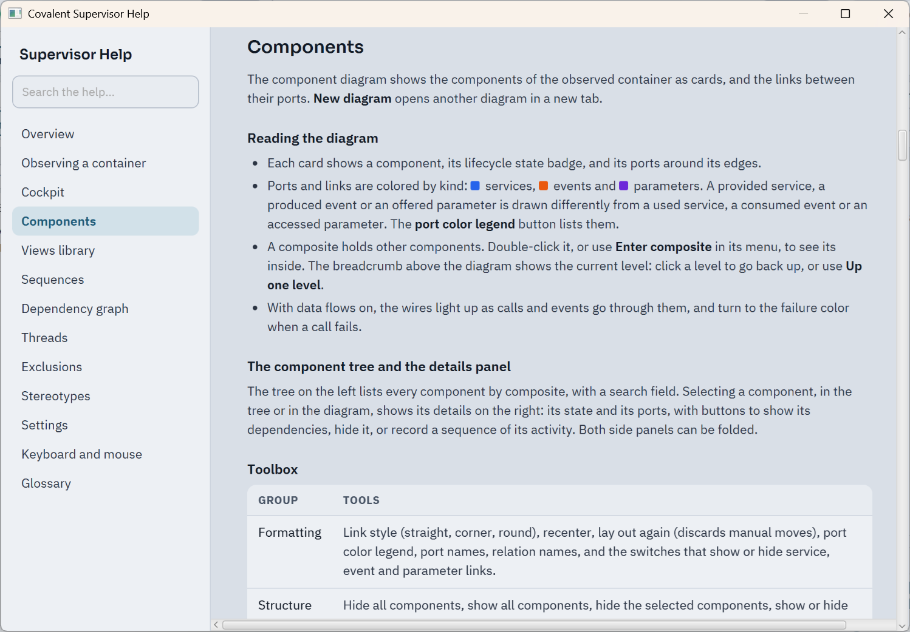

# Summoning the Supervisor

The supervisor does not open with the application. It starts the first time it is summoned,
at any moment of a long-running application, and it can be shown again as many times as needed
after its window has been closed. Two ways to summon it are available as soon as the extension
is enabled:

- **The keyboard shortcut**: <kbd>Ctrl</kbd>+<kbd>Shift</kbd>+<kbd>F12</kbd> in any JavaFX or
  Swing/AWT window of the application. Another combination is chosen with the
  `covalent.supervision.shortcut` system property, for example
  `-Dcovalent.supervision.shortcut=Ctrl+Shift+F11`; the value `none` removes the shortcut.
- **The JMX operation**: the `org.opales.covalent:type=Supervision` MBean of the application's JVM
  has an `openSupervisor` operation. JConsole and VisualVM list the local JVMs without any
  option: open the MBeans tab, then `org.opales.covalent`, `Supervision`, Operations, and invoke
  `openSupervisor`. This works for an application without any window of its own, such as a console
  application or a service, as long as the machine has a display. The `State` attribute of the
  MBean is `DORMANT` until the first summon, `STARTED` once the supervisor has been started (its
  window may be open or closed), and `UNAVAILABLE: <reason>` when it cannot be shown, for example
  on a machine without a display. The application is not affected in that case.
  A tool that connects by address instead of listing the local JVMs needs the application to open
  a JMX port: see [Connecting a JMX Tool to the Application](configuration.md#connecting-a-jmx-tool-to-the-application).

To open the supervisor once, as soon as the first container has started, add
`-Dcovalent.supervision.startup=open`; the default value is `dormant`, which is also the meaning of any
other value. The shortcut and the JMX operation stay available in both modes.

On macOS, the keyboard shortcut and the folder button of the Sequences band use Java's AWT toolkit next to JavaFX, a combination that is known to misbehave on that platform and that is not verified there. If one of them does, summon the supervisor with the JMX operation and open the logs folder from the file manager.

When the application does not run its own JavaFX toolkit, the supervisor starts one and keeps it
running when its window is closed, so that the window can be shown again. The toolkit stops when
the container that enabled the extension is disposed, and the supervisor window closes with it.
This requires that container to be a managed one (`Covalent.main` or
`Covalent.managedContainer(name)`); with a container created by `Covalent.container()`, closing
the supervisor window ends the toolkit and the supervisor cannot be shown again.

# Cockpit

The cockpit summarizes the observed container, across two tabs.

**Overview** shows live figures: how many components the container holds
and how many are composites, the links between components by kind
(services, events, parameters), the current service call and event
notification rates, the failures over the last five minutes, throughput by
kind of message over a chosen window, how many components are in each
lifecycle state and its recent transitions, one card per top-level composite, what the worker pools
are doing, and the busiest ports. Rates and throughput need the data
flows; they stay at zero while the flows are off.

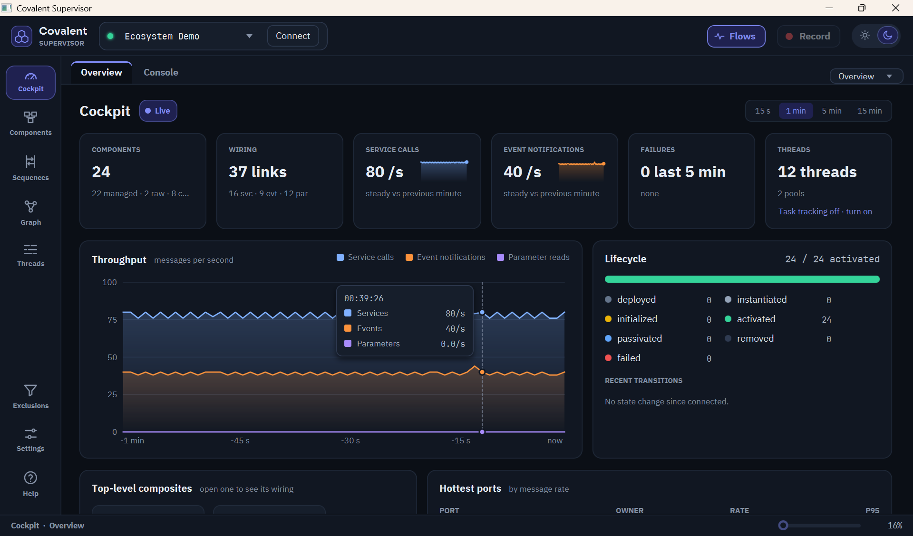

**Console** drives the lifecycle of the observed components - activate,
passivate, restart, remove, undeploy - component by component or for the
whole container (Activate all, Passivate all, Remove all), and offers only the
commands that make sense in a component's current state. A component whose
transition failed shows the failed state, and only Reset (or Reset all) is offered
for it: reset cleans up its composite and brings it back to deployed, without
starting it. It mirrors the container's composite structure: each
slice shows the direct children of one level - leaf components, and a
composite channel per child composite, with one state dot per component it
holds, a switch that applies to the whole sub-composite, and an entry to
drill into it. Only slices holding sub-composites are navigable; a
breadcrumb and an Up button go back. The **Standalone** slice gathers the
components outside any composite at the level shown. Because these
commands act on a running application, the console starts disarmed -
**Arm** enables it, for 60 seconds - and a command with lasting effects
asks for confirmation. Covalent's own internal components are shown but
cannot be driven. See [Lifecycle](managed-components.md#lifecycle) for the
states a component moves through.

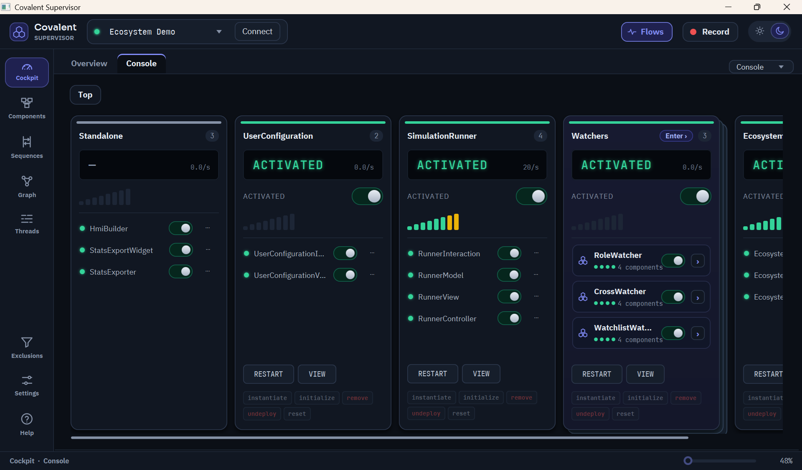

# Components

The component diagram shows the components of the observed container as
cards, and the links between their ports, colored by kind - services,
events and parameters - with a provided service, a produced event or an
offered parameter drawn differently from a used service, a consumed event
or an accessed parameter. Selecting a component shows its ports and state
in a details panel; with the data flows on, a wire lights up as calls and
events go through it, and turns to the failure color when a call fails.

Double-click a composite, or use **Enter composite** in its menu, to see
only its children; the breadcrumb above the diagram shows the current
level and goes back up. A port whose link leaves the level shown carries a
small navigation badge: it jumps straight to the component at the other
end, without losing the current drill-down.

A tree on the left lists every component by composite, with a search field.
Selecting a component, in the tree or in the diagram, shows its details on the
right, with buttons to show its dependencies, hide it or record a sequence of
its activity. A toolbox groups the formatting of the diagram (link style,
recentering, layout, port color legend, names, and the switches that show or
hide services, events and parameters), the hiding and showing of components and
dependencies, and the diagram actions: snapshot, new diagram, save view and
views library. Both side panels fold down to a slim strip with the chevron on
their inner edge, to leave the whole width to the diagram, and the supervisor
remembers which ones are folded.

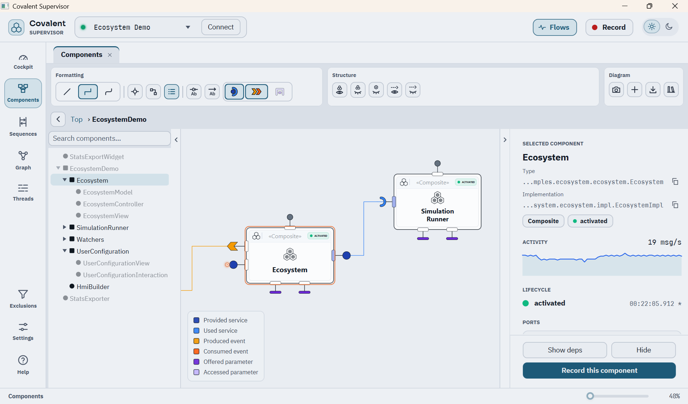

# Views Library

A component diagram view - the level shown, the hidden components, the
positions, the selection and the zoom - can be kept in the views library:

- **Save view…** (Ctrl+S) names the view, with an optional description, for
  the observed container; a name is unique for its container, and saving under
  an existing name replaces that view after a warning. In a tab opened from a
  view, or already saved, Ctrl+S replaces that view directly.
- **Views library…** (Ctrl+O) lists the views of the observed container, or of
  every container, most recently saved first or by name, each with a
  thumbnail. A view always opens in a new tab named after it. A view whose
  components are no longer all in the container is flagged, and opens without
  them after a warning that names them.
- Views can be renamed, deleted, exported to a file to share them, and
  imported from one.

Components and Sequences tabs can be renamed by double-clicking their title.
Renaming a tab opened from a view detaches it from that view: saving it then
proposes a new view instead of replacing the old one.

The views are kept in the views folder, set in the supervisor's
[Settings](#settings) (`~/.covalent/supervisor/views` by default), one
sub-folder per container, each view a `.cow` file (COvalent vieW) with a
`.png` thumbnail beside it.

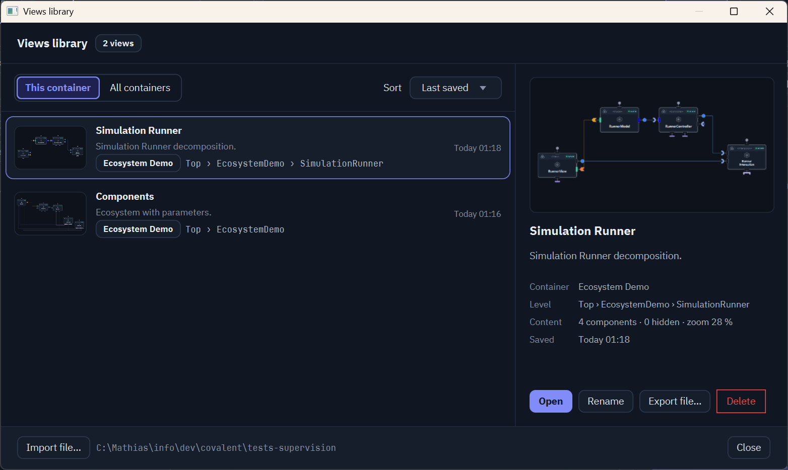

Its own UI is built on [`covalent-hmi`](hmi.md)'s `ActionManager`, the same
mechanism available to any application - see the [Covalent HMI
Guide](hmi.md) for `HmiCore` and `ActionManager`.

# Sequences

A sequence diagram records the messages exchanged between components while
it runs - service calls and their returns, event notifications, parameter
reads and the actions one component triggers on another. A recording needs
the data flows on; it starts by selecting one or more components and
**Record** in a component diagram (or from the menu of a link, between its two
components), or from a thread in [Threads](#threads), and goes on until **Stop**, or **Record** again from
anywhere - one recording runs at a time.

While it runs, **Live drawing** draws the messages as they arrive - when off,
the diagram stays as it is and catches up once turned back on - and **Follow
live** keeps the latest message in view. The kind switches show or hide
services, events, parameters and actions.

The timeline covers the whole recording, cut into time slices showing how
many messages each slice carried and how long its slowest call took.
Clicking a message shows its two ends, its interface and method, its
thread, its arguments, its result or failure, and its duration - with, for
an asynchronous event, how long it waited in the delivery queue before its
consumer was notified, shown apart. The panel on the right that shows these
details folds down to a strip, like those of Components. **Save the log** saves the recorded
messages, filtered or not, as text, CSV or JSON Lines, and the folder
button beside it opens the logs folder. A setting writes each recording
to a file of that folder as it goes, so that the log survives a crash;
the settings also give the format and the folder.

A CSV log copies the text of the calls as they were, arguments and failure
messages included, and does not neutralize values that start with `=`, `+`
or `@`. A spreadsheet opens such a value as a formula, so look at a log
that comes from an application you do not trust in a text editor first, or
choose the text or JSON Lines format.

Arguments and results are recorded as the text of their `toString()`, cut to 300
characters, with collections and arrays summed up to their first elements.
Nothing is masked: a password, a token or personal data passed to or returned by
a call appears in the message details and in the saved logs. Do not record
sequences on calls that carry such data, or keep the logs as safely as the data
itself.

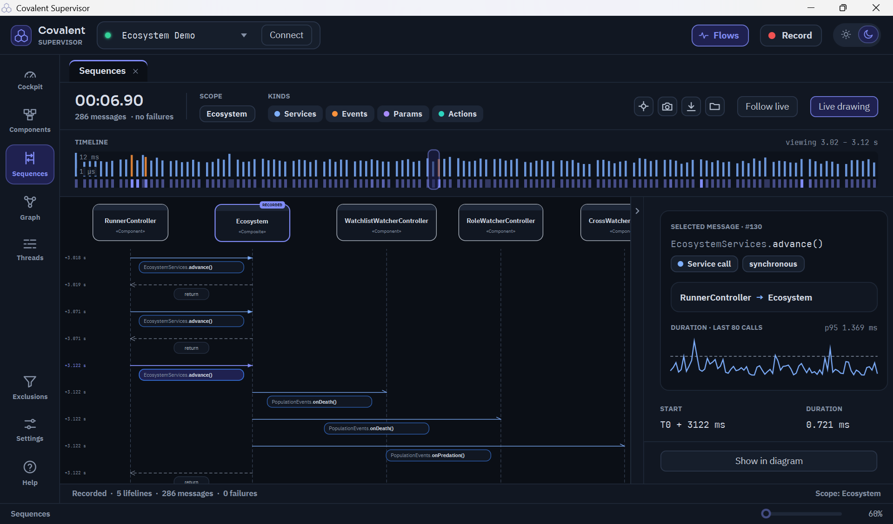

# Dependency Graph

The dependency graph shows which component depends on which, through its
ports: a component depends on the components whose services it uses, whose
events it consumes and whose parameters it accesses. It is computed
each time it is opened, while the container is started, whatever the
container parameters. Circular dependency checking only governs the
verification made at start - see [Circular Dependency
Detection](managed-components.md#circular-dependency-detection).

Composition links join each composite to its children, drawn as UML
compositions; a cycle that goes through a composite is one that goes
through any of its children, since a composite only starts once all of
them have. The **Cycles detected** panel lists the circular dependencies
found, each with its own color on its components and the dependencies that
make it, and the **Statistics** panel gives the number of components,
dependencies, cycles and isolated components. The panel on the right, which
holds both, folds down to a strip like the component tree.

A large graph can be scoped from the component tree on its left, a panel that
folds like those of Components. A click on a composite shows it and all its
descendants down to the leaf components, with the dependencies between them; a
click on a leaf centers it; the triangle opens or closes a composite without
scoping; the breadcrumb above the graph goes back up, to the whole graph.
**Outside neighbors** adds the components outside the scope that they depend on
or that depend on them; without it, the status bar counts the dependencies with
the outside that are hidden. The cycles and the statistics follow the scope, and
each scope keeps its own layout.

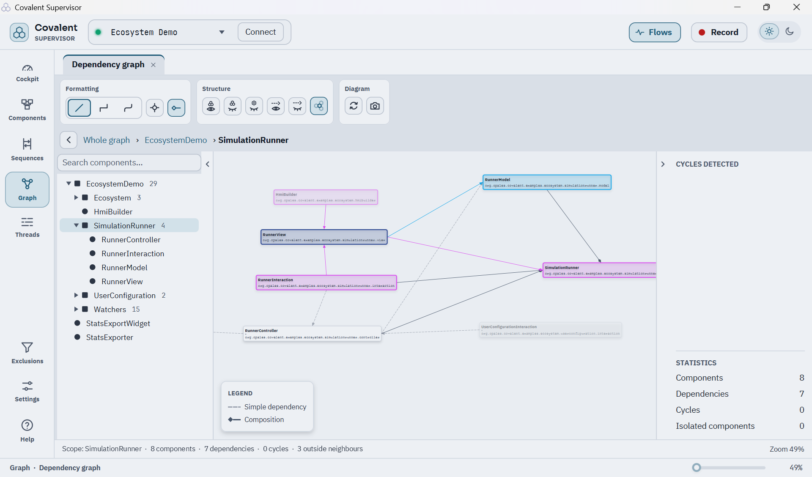

# Threads

The **Threads** entry of the rail shows what the observed container's worker
pools are doing: the asynchronous events pool, and the async manager's general
and dedicated pools. It samples them four times a second through
`EventsWorkersServices` and `AsyncWorkersServices` (see [Observing the Worker
Pools](configuration.md#observing-the-worker-pools)), and reads each of their
threads' state, lock and CPU time from the JVM. Each thread shows as a lane of
its states - runs, waits, blocked on a monitor, idle - on a time axis shared by
every lane, under each pool's queue, occupancy, latencies and contention. The
last quarter of an hour is kept; the range selector shows the last 15 seconds,
minute, 5 or 15 minutes.

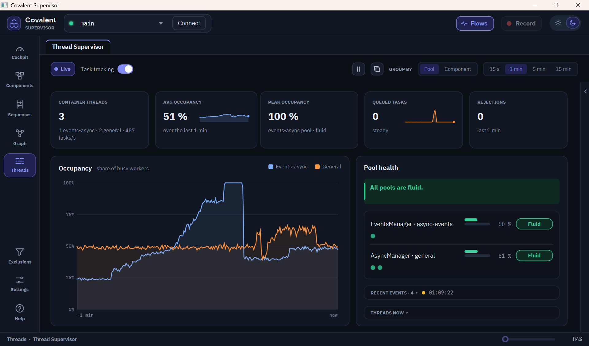

With neither option on, Threads shows what a general-purpose JVM tool such as
VisualVM shows: the state of each thread over time (running, waiting, blocked
on a monitor) and deadlocks. On top of that it knows the container's worker
pools: their workers, queues, rejected tasks and contention, and it can resize
them live. What it cannot tell is whether a waiting pool thread is idle or
holds a task.

**Task tracking** asks the pools which task each worker runs and how long
tasks wait and run. It is what makes Threads really useful, and it is worth
turning on whenever you work with it: it tells a waiting thread from an idle
one, names the task on each lane, measures occupancy as a share of time rather
than as an instant sample, gives waiting and running times and the load per
component, and reports long tasks. It is off until you turn it on, in the
panel's header or from the cockpit's Threads tile, or with the option of
[Settings](#settings) that does it at each connection.

**Data flows** observe the calls of the whole container. In Threads, they show
under **Calling threads** the application's own threads that run component
calls (a simulation thread, the JavaFX thread), with their call rate, report
their long calls, and make it possible to record a sequence from a thread.

| Threads feature | Without either option | Task tracking | Data flows |
|---|---|---|---|
| Thread states from the JVM (running, blocked on a monitor) and the lock held | yes |  |  |
| Queues, rejected tasks, pool contention, deadlocks, live tuning | yes |  |  |
| Pool occupancy | instant sample, jumping between 0 and 100 % | share of the time spent in tasks |  |
| Telling a waiting thread from an idle one | no: shown as *waits or idle* | yes |  |
| Name of the task a thread runs | no | yes |  |
| Short tasks (green bar) | no | yes |  |
| Tasks per second, 95th percentile of waiting and running times | no | yes |  |
| Group by component | no | yes |  |
| Long task reports | blocking on a monitor only | tasks of the pools' workers | calls of the calling threads |
| Calling threads, with their call rate | *data flows off* |  | yes |
| Record button | grayed out |  | yes |
| Components known for a pool worker when recording | no | yes | yes |
| Cockpit Threads tile | threads, pools, saturated pools, rejections, deadlock, and a link to turn tracking on | adds the busy percentage over the last minute |  |
| Scope |  | the container's worker pools | the whole container (also the diagrams' live activity, the cockpit's rates and the recordings) |

**Costs.** Task tracking costs almost nothing: in [our
tests](#appendix-overhead-measurements) it made no measurable difference to the
time or the garbage of a task, and the memory it keeps is negligible. Data
flows cost much more, because every call between components produces
instrumentation events that the supervisor then processes. With the
supervisor connected, that is about 7 % of one CPU core at 1,000 calls per
second, 14 to 30 % at 5,000 and about 42 % at 20,000. Each call also creates about 5
kilobytes of short-lived objects that the garbage collector must clean up
(about 50 megabytes per second at 10,000 calls per second); the memory they
keep permanently is small: about half a megabyte in our test container, and it
did not grow with the number of calls. A container at rest is not affected.
Turn the flows off when you do not need them, especially on code that makes
many calls. Recording a sequence adds to
this cost, because the arguments of each call are printed and the messages are
kept.

With task tracking on, **Group by › Component** shows the load per component
instead of the lanes: a pool's worker takes any task, so a thread belongs to no
component; each component - the one that submitted an async task, or the
consumer of an event - gets one row of how many pool workers were busy working
for it over time, against every pool's workers.

While the data flows are on, the panel also shows the application's own threads
that run the components' calls, such as a simulation thread or the JavaFX
application thread, under **Calling threads**. With a thread selected, the
header's **Record** button records the last component it worked for, or, once a
moment is picked on its lane, the components it worked for then.

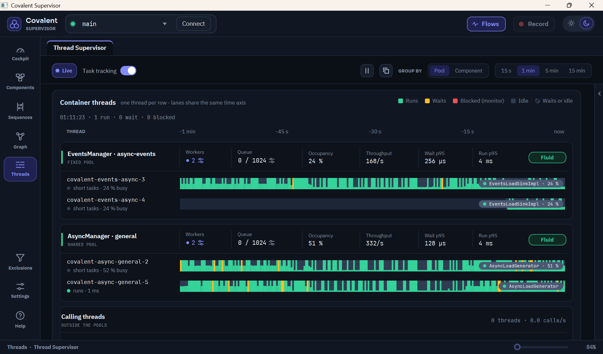

The events pool and the general pool can be tuned from their headers: their
workers and queue capacity, set through `EventsManagerParameters` and
`AsyncParameters`, which apply at once. A tuned size lasts until the container
restarts, its configuration then applying again, so that a size can be tried
before it is configured. Dedicated pools keep their single worker.

A deadlock among the pools' threads shows as a red banner. A report of each
deadlocked thread - its state, the lock it waits for, the locks it holds and
its stack - can be copied, and **Interrupt threads** frees those waiting
interruptibly, after a confirmation; a thread blocked on a `synchronized`
monitor can only be freed by restarting the container.

# Exclusions

Excluded components appear neither in the diagrams nor in the recordings,
and excluding a composite excludes everything it contains.
The component of the supervisor's own interface (`HmiCore`) is excluded
by default, and cannot be removed. A component can be added by its fully
qualified name, and removed again. **Exclude internal components** hides Covalent's own
components marked `@Internal`; turning it off shows them. Exclusions are
kept from one run to the next, including across applications: a component
excluded while observing one application stays excluded whenever that
application is observed again.

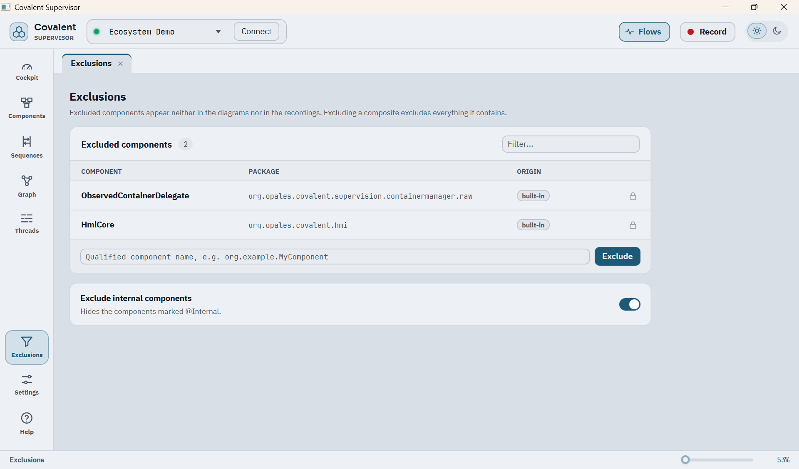

# Stereotypes

A stereotype is the short label written in a component's card and in the
sequence diagrams, such as `Repository` or `Composite`. A component takes the
stereotype matching the end of its name - the longest matching ending wins -
and, when none matches, the one the metamodel gives it: Composite, Component,
Raw, Interface or Internal.

The function has no button on the rail: it is the **Stereotypes** tab of
[Settings](#settings), also opened by **Component stereotypes…** in the General
tab. The tab lists the name endings and their stereotype. The supervisor ships
endings of its own, such as `Manager`, `Model`, `Store` and `View`, marked
*built-in*; they are locked, unless **Allow removing the built-in
stereotypes** is ticked, and a built-in stereotype that was removed stays
removed from one run to the next. Others can be added, each with a name ending
(letters, digits, `_` and `$`) and the stereotype to show, which has a length
limit; an ending that already has a stereotype is refused. An added stereotype
can be removed again, and **Restore the initial list** brings back the built-in
stereotypes and removes the added ones, as at installation. The filter field
narrows the list, and **Try a component name** shows which stereotype a name
gets, which ending won and which other endings also match. The stereotypes
added or removed are kept from one run to the next.

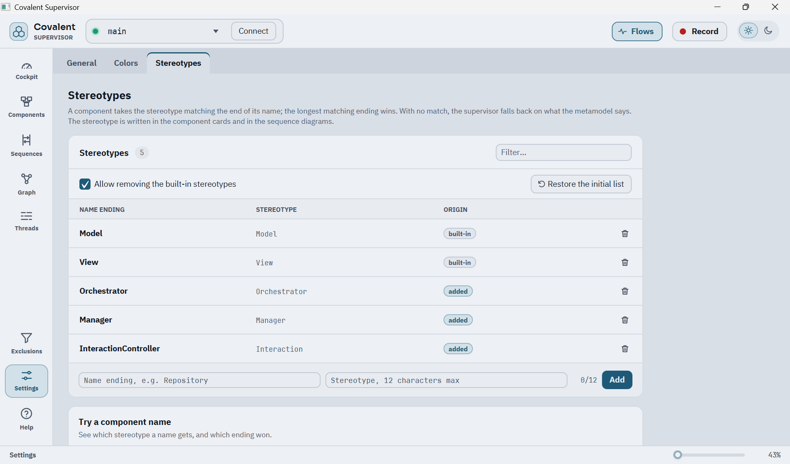

# Settings

Settings has three tabs: General, Colors and Stereotypes.

**General** sets whether data flows and thread task tracking turn on as
soon as the supervisor connects to a container, the threshold for a long
task report in [Threads](#threads), whether the diagram lays itself out
again when components are hidden, whether a new sequence diagram starts
with live drawing on, how a sequence timeline draws volume and duration
together, the snapshot and views folders, and the supervisor's language:
the system language (English when it is neither English nor French),
English or French, applied at the next start. The help follows the same
language. Its **Components** card opens the [Exclusions](#exclusions)
function and the [Stereotypes](#stereotypes) tab.

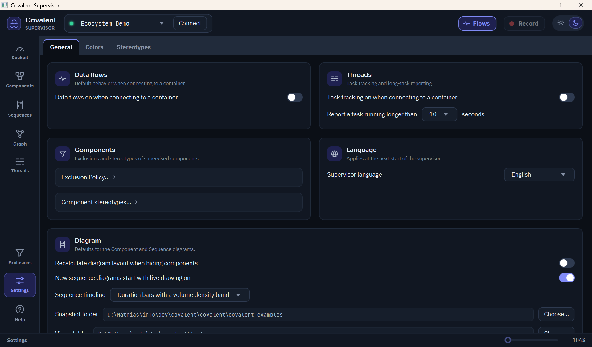

**Colors** sets the palette used for cards, status badges, ports and
wires - one per theme, light and dark - with a live preview; hovering a
color shows where it applies. **Restore default colors** brings back the
default colors of the current theme, after a confirmation; the other theme
keeps its own.

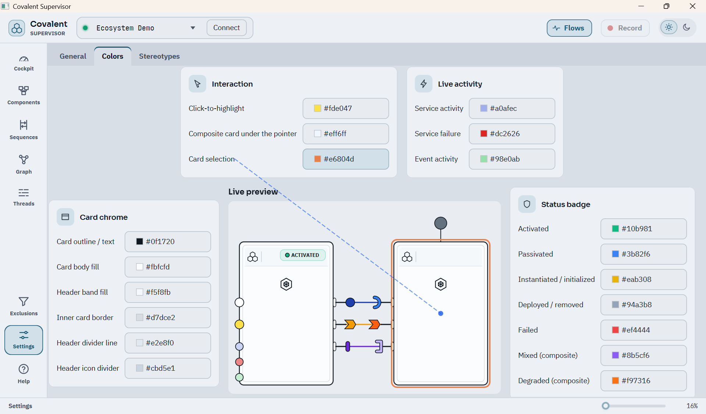

**Stereotypes** holds the table described in [Stereotypes](#stereotypes).

The light and dark themes themselves switch from the header, at any time.
Every setting is kept from one run to the next.

# Writing a Custom Extension

`component-viewer` is itself an ordinary `CovalentExtension` - the same
public SPI any application can implement to start its own optional runtime
tooling alongside a Covalent container. See [Writing Your Own
Extension](configuration.md#writing-your-own-extension) for the full
walkthrough.

# Appendix: Overhead Measurements

These measurements back the costs given in [Threads](#threads). They are
orders of magnitude taken from a micro-benchmark, not guarantees.

**Setup.** A Linux virtual machine with 2 virtual
CPUs of an Intel Core i7-13620H laptop processor and 4 GB of memory, with
OpenJDK 21.0.12. The observed container holds one
component providing a trivial service, which another caller invokes in a loop.
The supervisor's observation bridge is connected, without the JavaFX
interface. Events are asynchronous, as by default. Values are medians taken
after a warm-up. On another machine the absolute values change, the
proportions much less.

**Task tracking.** Tasks are submitted to the async manager in batches of 200;
the time is the wall time to submit and run one task. Each case ran twice.

| | Tracking off | Tracking on |
|---|---|---|
| Empty task, time per task | 1.31 µs and 1.40 µs | 1.30 µs and 1.39 µs |
| Task of 20 µs, time per task | 13.1 µs and 13.2 µs | 13.0 µs and 13.6 µs |
| Memory allocated per task | 380 bytes | 376 bytes |

The differences are within the measurement noise, below 5 %.

**Data flows.** One call of a component's service by another component.

| Situation | Calling thread, per call | CPU of the whole process, per call | Share of one core |
|---|---|---|---|
| Flows off | 0.13 µs | 0.13 µs | |
| Flows on, no supervisor connected, flat out | 0.5 µs | 0.5 µs | |
| Flows on, supervisor connected, 1,000 calls/s | 16 µs | 66 µs | about 7 % |
| Same, 5,000 calls/s | 16 µs | 28 to 60 µs | 14 to 30 % |
| Same, 20,000 calls/s | 15 µs | 21 µs | about 42 % |
| Same, 50,000 calls/s | 11 µs | 14 µs | about 68 % |
| Same, flat out (about 150,000 calls/s) | 6.8 µs | 7.8 µs | a whole core |

At low rates each call wakes the thread that processes the instrumentation
events, which makes the cost per call higher; the cost per second stays
moderate. At 5,000 calls per second the three runs gave 28, 59 and 60 µs of CPU per call, hence the wide range. With the supervisor connected and no call, the process uses about 1 %
of a core, with the flows on or off.

| Memory allocated per call, with synchronous events | |
|---|---|
| Flows off | 64 bytes |
| Flows on, supervisor connected | 4.6 KB |
| Same, with the call stream of a recording enabled (no consumer) | 5.7 KB |

These allocations are short-lived objects. The recording figure leaves out the
sequence diagram that consumes the stream, whose own cost is not part of this figure.

**Memory kept.** The heap in use after a full garbage collection, compared with
the same container before task tracking and data flows were turned on.

| Situation | Extra heap |
|---|---|
| Task tracking on, after 200,000 tasks | 24 KB, within the noise |
| Data flows on, after 1,000,000 calls | about 0.5 MB |
| Same, after a further 200,000 tasks and 1,000,000 calls | no further growth |
| Both turned off again | about 0.5 MB: the memory is not released |

The test container has a single component. A container with many components,
ports or calling threads keeps more, since the statistics are per port and per
calling thread; these figures do not cover that.

<!-- doc-nav:bottom -->
[Home](../README.md) | [Previous: Covalent Raw Components Guide](raw-components.md) | [Next: Covalent HMI Guide](hmi.md)
<!-- /doc-nav:bottom -->
